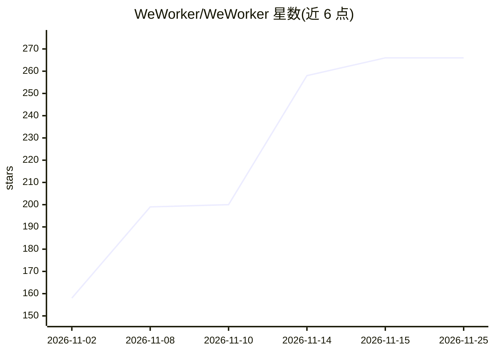

# WeWorker/WeWorker

⭐ 266 · JavaScript · Apache-2.0 · 推送 2026-11-22 · [GitHub](https://github.com/WeWorker/WeWorker) · [官网](https://www.weworker.cc) · 组织维护 · 中文 README

**开源桌面 AI agent：用自然语言在网站执行真实操作**

Electron 桌面应用，将自然语言任务经 AI agent 选择 Adapter 并通过 Chrome 扩展或内置 Toolkit 运行时转换为真实浏览器操作，内置 33 个公共网站 Adapter，覆盖邮件、购物、社交、内容、旅行、开发者工具等站点，统一通过 webcli call 接口调用。登录、提交、购买、支付等关键步骤由用户控制；支持定时任务、通知推送与本地站点记忆。提供 Windows/macOS 安装包，也可从源码运行（需 Node.js 22.x）。任务内容会发送给用户选择的模型服务商。

## 筛选速览

| 维度 | 判定 | 备注 |
|---|---|---|
| AI 角色 | `ai-native` | 本体是模型或模型工具 |
| 许可风险 | `permissive` | Apache-2.0 |
| 部署形态 | `desktop` | 安装包/桌面程序 |
| 模型依赖 | — | README 未给出锁定关系 |
| 硬件要求 | — | 无带数字的原话,不猜 |
| 安装摩擦 | `low` | 无编译、无系统依赖或容器化 |
| 成熟度 | — | 结构信号不足 |

## 能力要点

- 内置 33 个公共网站 Adapter（QQ 邮箱、京东、小红书、B 站等）
- 双运行时：Chrome 扩展 Adapter 与内置 Toolkit Adapter，统一 webcli call 入口
- 网站探索 agent 协助创建、验证和维护网站工具
- 多模型服务商：Anthropic、Zhipu、DeepSeek 及兼容自定义端点

## 适用场景

- 跨网站收集、比较并汇总信息
- 自动化检查邮件、搜索内容、填写表单等重复性网页工作
- 为常用网站编写 Adapter 并通过命令行调用

## 场景标签

`浏览器自动化` `AI 助手` · 领域:效率与自动化

## 证据(README 行号)

> L7: Natural-language tasks → Adapters → real browser actions. Includes 33 website Adapters for Windows and macOS.
> L21: WeWorker turns a natural-language request into real website actions. Its AI agent selects an Adapter and operates t
> L47: - **Multiple model providers:** Anthropic, Zhipu, DeepSeek, and compatible custom endpoints.

## 星数曲线

2026-11-02 158 → 2026-11-25 266（+108）

---
*卡片 v1 · prompt 1.4 · 生成 2026-11-25 · 置信度 high · 依据 README sha `ad059a3ad95d` · [字段定义](../../DATASET.md)*
