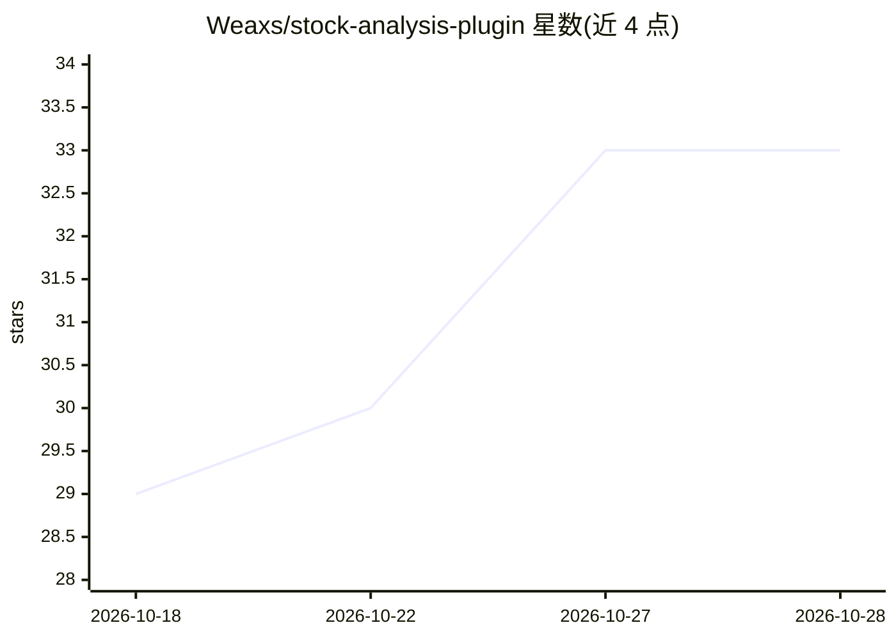

# Weaxs/stock-analysis-plugin

⭐ 33 · Python · MIT · 推送 2026-10-27 · [GitHub](https://github.com/Weaxs/stock-analysis-plugin) · [官网](https://www.npmjs.com/package/@weaxs/stock-analysis-plugin) · 个人维护 · 中文 README

**给 AI agent 用的多市场股票分析/选股/回测插件（70 工具+21 技能）**

面向 AI agent 框架的股票分析工具插件，覆盖 A股/港股/美股/日股/韩股/台股，提供 70 个工具（行情、技术分析、资金流、估值、财报、舆情、风险筛查等）与 21 个 SKILL.md 工作流（综合分析、多因子选股、YAML DSL 策略回测及缠论/波浪等 18 个策略）。底层为共享的 Python CLI 工具集，上层适配 Pi Agent、Hermes、OpenClaw 与 DeepSeek Harness (dsh) 四个平台的注册机制。数据源支持 11 个来源自动 failover，可选环境变量配置 Tushare/Longbridge/Finnhub 等鉴权源。无状态工具不保存持仓或账户历史，部分实验性指标标注 not_validated。

## 筛选速览

| 维度 | 判定 | 备注 |
|---|---|---|
| AI 角色 | `ai-ecosystem` | LLM/agent 周边工具 |
| 许可风险 | `permissive` | MIT |
| 部署形态 | `library` | 以包/库形式分发 |
| 模型依赖 | locked-api |  |
| 硬件要求 | — | 无带数字的原话,不猜 |
| 安装摩擦 | `low` | 无编译、无系统依赖或容器化 |
| 成熟度 | — | 结构信号不足 |

## 能力要点

- 70 个工具 + 21 个 SKILL.md 工作流，覆盖六个市场
- 11 个数据源自动 failover，A 股链路带粘性优选
- YAML DSL 策略回测引擎，按需最多 3 轮参数优化
- 同一工具集适配 Pi Agent / Hermes / OpenClaw / dsh 四个平台

## 适用场景

- 让 AI agent 对个股做多维度综合分析并输出研报
- 通过对话在全市场按多因子条件筛选股票
- 用自然语言触发策略回测或缠论/波浪等特定视角分析

## 场景标签

`金融量化` · 领域:学习与行业

## 证据(README 行号)

> L8: A 股 / 港股 / 美股 / 日股 / 韩股 / 台股综合分析、多因子选股和策略回测工具集，可作为 Pi Agent Extension、Hermes Agent Plugin、OpenClaw Plugin，或 DeepSeek
> L10: 底层共享同一套 Python CLI 工具和 SKILL.md 工作流，上层分别适配四个平台的注册机制。
> L21: - **四平台适配** — 同一套工具同时支持 Pi Agent、Hermes Agent、OpenClaw 和 dsh

## 星数曲线

2026-10-18 29 → 2026-10-28 33（+4）

---
*卡片 v1 · prompt 1.4 · 生成 2026-10-26 · 置信度 high · 依据 README sha `4efa96fd5d70` · [字段定义](../../DATASET.md)*
