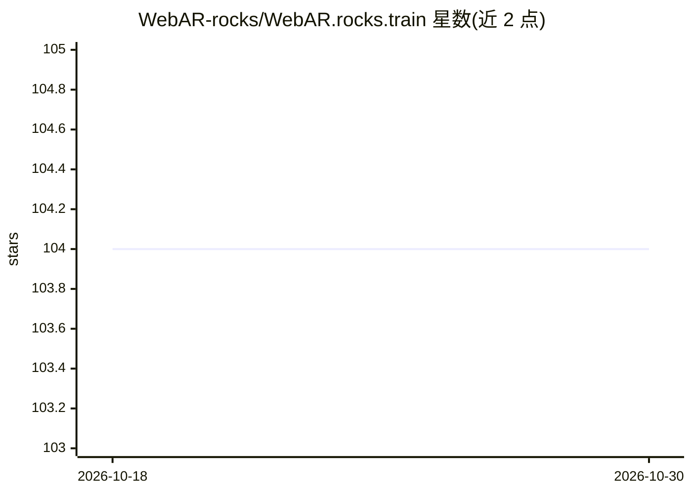

# WebAR-rocks/WebAR.rocks.train

⭐ 104 · JavaScript · MIT · 推送 2026-08-03 · [GitHub](https://github.com/WebAR-rocks/WebAR.rocks.train) · [官网](https://webar.rocks) · 组织维护

**浏览器内神经网络训练环境：训练自有物体检测与 6DoF 位姿模型**

运行在浏览器中的集成训练环境（trainer.html），使用 WebGL 在 GPU 上完成前向/反向传播与参数更新，无需第三方机器学习框架（TensorFlow/Torch/Keras）或 CUDA 安装。主要用途是训练物体检测、跟踪与 6DoF 位姿估计模型：用 THREE.js 从 3D 模型（.OBJ/.GLTF/.GLB）实时生成合成训练数据，训练过程可通过网页界面实时监控，模型可导出为 JSON 并配合 WebAR.rocks.object 等 WebAR 库使用。要求 WebGL1 及浮点纹理扩展，界面面向桌面端，推荐配备 NVIDIA GeForce GPU 的台式机。

## 筛选速览

| 维度 | 判定 | 备注 |
|---|---|---|
| AI 角色 | `ai-ecosystem` | LLM/agent 周边工具 |
| 许可风险 | `permissive` | MIT |
| 部署形态 | `None` |  |
| 模型依赖 | — | README 未给出锁定关系 |
| 硬件要求 | — | 无带数字的原话,不猜 |
| 安装摩擦 | `medium` | 含编译或系统依赖之一 |
| 成熟度 | — | 结构信号不足 |

## 能力要点

- 训练全流程在 GPU 上完成，无需 TensorFlow/Torch/Keras 或 CUDA
- 用 THREE.js 从 3D 模型实时生成合成训练数据，替代人工标注图像
- 网页界面实时监控训练过程，模型导出为 JSON 供 WebAR 应用使用
- 支持物体检测、跟踪、6DoF 位姿估计与图像分类训练

## 适用场景

- 训练检测特定实物（如打火机、易拉罐）的神经网络模型
- 为 WebAR 应用制作 6DoF 物体跟踪模型
- 在浏览器里以 MNIST 等脚本试验神经网络训练流程

## 场景标签

`目标检测` · 领域:感知与多模态

## 证据(README 行号)

> L13: This repository hosts a full **Integrated Training Environment**. You can train your own neural network models dire
> L15: The main use case is **object detection and tracking and pose estimation**: you can train a neural network model to
> L17: This software is fully standalone. It does not require any third party machine learning framework (*Google TensorFl

## 星数曲线

2026-10-18 104 → 2026-10-30 104（+0）

---
*卡片 v1 · prompt 1.4 · 生成 2026-10-23 · 置信度 high · 依据 README sha `b0a81630a7b5` · [字段定义](../../DATASET.md)*
