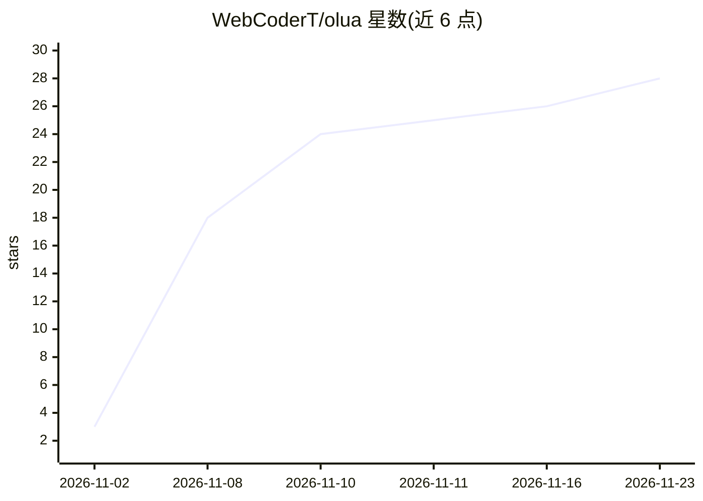

# WebCoderT/olua

⭐ 28 · TypeScript · MIT · 推送 2026-11-22 · [GitHub](https://github.com/WebCoderT/olua) · [官网](http://yimw.cn) · 个人维护 · 中文 README

**AI 全程编写代码的 2D 网页 RPG 三端开源实现**

基于 Cocos Creator 3.8.7 客户端、NestJS + SQLite 服务端、React 管理后台的三端 MMORPG 风格原型：覆盖账号角色、地图探索、服务器结算的战斗、装备词缀品质、战魂/称号/军衔三条成长线、帮会组队社交与运营后台。项目自述每行代码均由 AI 生成，人只负责提需求与验收，并把这一过程记录在提交历史和 docs 中。提供 Docker Compose 一键部署与 make 命令集，游戏素材 2.4G 经 Release 分卷分发，需另行下载。

## 筛选速览

| 维度 | 判定 | 备注 |
|---|---|---|
| AI 角色 | `ai-enhanced` | 去掉 AI 部分产品仍成立 |
| 许可风险 | `permissive` | MIT |
| 部署形态 | `self-host` | docker 或自建部署 |
| 模型依赖 | — | README 未给出锁定关系 |
| 硬件要求 | — | 无带数字的原话,不猜 |
| 安装摩擦 | `low` | 无编译、无系统依赖或容器化 |
| 成熟度 | — | 结构信号不足 |

## 能力要点

- 客户端/服务端/管理后台三端结构，伤害与掉落由服务器结算
- 自述全部代码由 AI 生成，提交历史与 docs 记录开发过程
- Docker Compose 起五个容器，对外仅开放 80/8080 端口
- 40 篇代码文档 + make verify 类型检查与跨端审计流程

## 适用场景

- 在浏览器直接玩或自部署一套网页 RPG
- 研究 AI 独立完成完整项目的需求拆解与纠偏记录
- 参考三端接口自动生成与服务端权威结算架构

## 场景标签

`教程课程` · 领域:学习与行业

## 证据(README 行号)

> L129: **每一行代码都是 AI 写的。** 人只做三件事：提需求、看效果、说不满意。
> L131: 所以这个仓库除了游戏本身，也是一份「AI 能不能独立写完一个完整项目」的实测记录：

## 星数曲线

2026-11-02 3 → 2026-11-23 28（+25）

---
*卡片 v1 · prompt 1.4 · 生成 2026-11-18 · 置信度 mid · 依据 README sha `ba45a9eebce0` · [字段定义](../../DATASET.md)*
