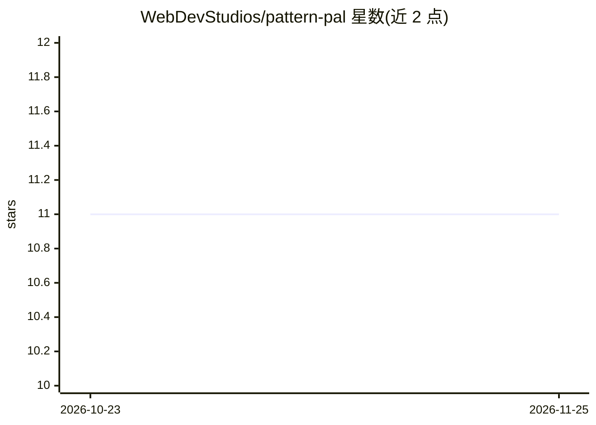

# WebDevStudios/pattern-pal

⭐ 11 · PHP · GPL-3.0 · 推送 2026-07-21 · [GitHub](https://github.com/WebDevStudios/pattern-pal) · [官网](https://pluginpal.app) · 组织维护

**WordPress 插件：用文本描述在 Gutenberg 中生成自定义块图案**

Pattern Pal 是一款免费的 WordPress 插件，接入 OpenAI 的 GPT-4o 模型，用户在 Gutenberg 块编辑器中输入文字描述即可生成有效的 WordPress 块标记，并直接插入编辑器。插件会读取当前主题的配色以保持风格一致；用户需自行提供 OpenAI API Key，保存在 WordPress options 表中。安装方式为手动下载 release 并上传至插件目录后激活。

## 筛选速览

| 维度 | 判定 | 备注 |
|---|---|---|
| AI 角色 | `ai-native` | 本体是模型或模型工具 |
| 许可风险 | `viral` | GPL-3.0 |
| 部署形态 | `None` |  |
| 模型依赖 | — | README 未给出锁定关系 |
| 硬件要求 | — | 无带数字的原话,不猜 |
| 安装摩擦 | `low` | 无编译、无系统依赖或容器化 |
| 成熟度 | — | 结构信号不足 |

## 能力要点

- 基于 OpenAI GPT-4o 生成 WordPress 块标记
- 读取主题配色生成风格一致的图案
- 生成的图案即时插入 Gutenberg 编辑器并可继续编辑
- 用户自备 OpenAI API Key，在设置页配置

## 适用场景

- 用文字描述快速生成 hero 区块等复杂块布局
- 在 Gutenberg 编辑器中直接生成并插入块图案
- 按当前主题配色生成风格一致的图案

## 场景标签

`代码生成` · 领域:编码与开发

## 证据(README 行号)

> L5: **Pattern Pal** is a free AI-powered WordPress® plugin that allows you to generate custom block patterns in the Gute
> L11: - **Gutenberg Integration** -- Works directly in the WordPress® Block Editor.

## 星数曲线

2026-10-23 11 → 2026-11-25 11（+0）

---
*卡片 v1 · prompt 1.4 · 生成 2026-11-18 · 置信度 high · 依据 README sha `390ad51e8e53` · [字段定义](../../DATASET.md)*
