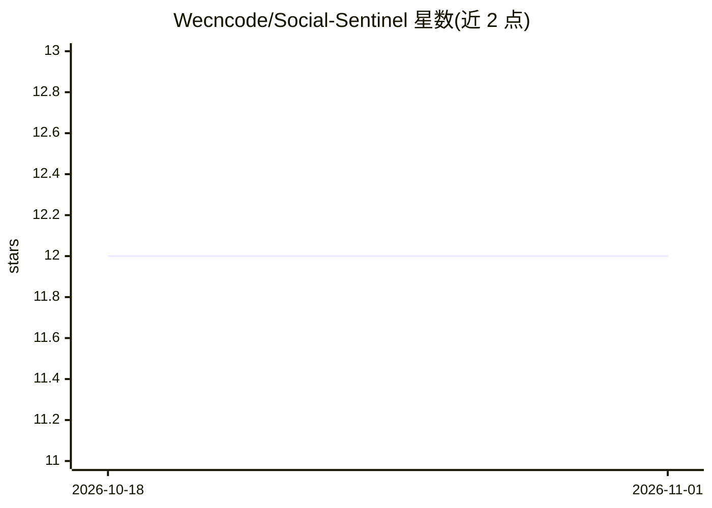

# Wecncode/Social-Sentinel

⭐ 12 · HTML · MIT · 推送 2026-09-28 · [GitHub](https://github.com/Wecncode/Social-Sentinel) · 个人维护

**检测邮件/短信中社工话术的 NLP 分类分析工具**

基于 Python、Scikit-Learn 与 Gradio 的开源 NLP 工具及交互式 Web 应用：输入邮件或短信文本，经 TF-IDF（unigram+bigram）向量化后，由四个分类算法（朴素贝叶斯、逻辑回归、随机森林、SVM）实时输出 phishing/safe 判定与置信概率分布，并用次级逻辑回归分类器标记紧迫感、权威利用、心理操纵三类战术特征，同时提取影响预测的 n-gram 触发词。零 GPU 需求，可在 CPU 或 Google Colab 运行，依赖自备 CSV 格式启动数据集。项目自我定位为学生学习数据科学、AI 与网络安全的入门/中级项目。

## 筛选速览

| 维度 | 判定 | 备注 |
|---|---|---|
| AI 角色 | `ai-native` | 本体是模型或模型工具 |
| 许可风险 | `permissive` | MIT |
| 部署形态 | `None` |  |
| 模型依赖 | — | README 未给出锁定关系 |
| 硬件要求 | — | 无带数字的原话,不猜 |
| 安装摩擦 | `low` | 无编译、无系统依赖或容器化 |
| 成熟度 | — | 结构信号不足 |

## 能力要点

- 四种分类算法实时对比评估同一消息
- 紧迫感/权威利用/心理操纵三类战术特征标记
- TF-IDF 向量化提取并展示影响预测的 n-gram 触发词
- 零 GPU 需求，CPU 或 Google Colab 即可运行

## 适用场景

- 分析可疑邮件或短信是否含钓鱼/社工话术
- 查看具体哪些词汇触发分类判定
- 在 Colab 中学习文本分类与社工检测的入门实践

## 场景标签

`网络安全` `教程课程` · 领域:学习与行业

## 证据(README 行号)

> L3: Social Sentinel is an open-source, lightweight Natural Language Processing (NLP) tool and interactive web applicatio
> L22:  - The primary classifier predicts the overall status (`phishing` vs. `safe`) and outputs confidence probabilities.

## 星数曲线

2026-10-18 12 → 2026-11-01 12（+0）

---
*卡片 v1 · prompt 1.4 · 生成 2026-11-01 · 置信度 high · 依据 README sha `4a6d97ab017c` · [字段定义](../../DATASET.md)*
