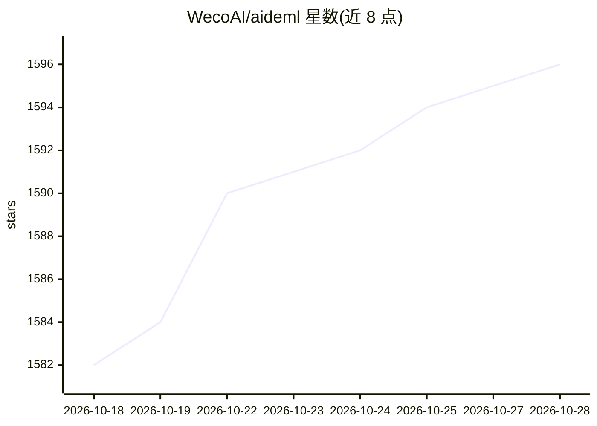

# WecoAI/aideml

⭐ 1,596 · Python · MIT · 推送 2026-10-16 · [GitHub](https://github.com/WecoAI/aideml) · [官网](https://weco.ai) · 组织维护

**面向研究者的 LLM 树搜索代理：自动撰写并迭代优化机器学习代码**

AIDE 算法的开源参考实现：以 LLM 引导的树搜索在代码空间中自主起草、调试并基准测试机器学习脚本，直到用户定义的指标达到最优。以 Python 包（pip 安装）形式提供，附 CLI、HTML 解树可视化与 Streamlit Web UI。代码与反馈模型支持 OpenAI、Anthropic、Gemini、OpenRouter 及经 OpenAI 兼容 API 接入的本地模型（如 Ollama），并提供 Docker 与源码开发安装。限制：本地小模型会有性能下降，且需自备 API key。

## 筛选速览

| 维度 | 判定 | 备注 |
|---|---|---|
| AI 角色 | `ai-native` | 本体是模型或模型工具 |
| 许可风险 | `permissive` | MIT |
| 部署形态 | `self-host` | docker 或自建部署 |
| 模型依赖 | local-ok | 支持本地模型 |
| 硬件要求 | — | 无带数字的原话,不猜 |
| 安装摩擦 | `low` | 无编译、无系统依赖或容器化 |
| 成熟度 | — | 结构信号不足 |

## 能力要点

- LLM 引导的代理式树搜索：每个脚本为节点，补丁派生子节点，指标反馈剪枝
- 自然语言指定数据集、目标与指标，无需 YAML 网格
- 附 HTML 解树可视化与 Streamlit Web UI
- 模型中立：OpenAI/Anthropic/Gemini/OpenRouter 及 OpenAI 兼容本地模型

## 适用场景

- 给定数据集用自然语言描述目标，自动产出高性能 ML 流水线
- 研究者替换搜索启发式、评估器或 LLM 后端做实验
- 复现 AIDE 论文或在其上构建新想法

## 场景标签

`编码 Agent` · 领域:编码与开发

## 证据(README 行号)

> L3: LLM‑driven agent that writes, evaluates & improves machine‑learning code.
> L15: **AIDE ML is the open‑source “reference build” of the AIDE algorithm**, a tree‑search agent that autonomously draft
> L32: - **Natural‑language task specification** Point the agent at a dataset and describe *goal* + *metric* in plain Engl

## 星数曲线

2026-10-18 1,582 → 2026-10-28 1,596（+14）

---
*卡片 v1 · prompt 1.4 · 生成 2026-10-21 · 置信度 high · 依据 README sha `65d158779771` · [字段定义](../../DATASET.md)*
