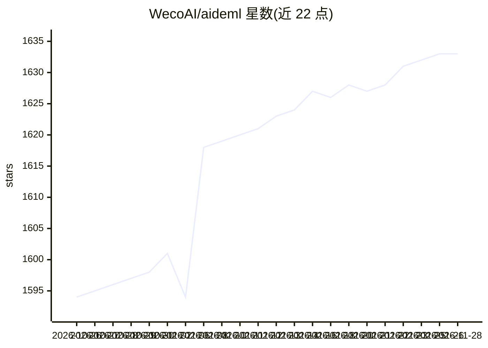

# WecoAI/aideml

⭐ 1,633 · Python · MIT · 推送 2026-11-21 · [GitHub](https://github.com/WecoAI/aideml) · [官网](https://weco.ai) · 组织维护

**面向研究者的树搜索 ML 工程自动化 agent**

AIDE ML 是 AIDE 算法的开源参考实现：以 LLM 驱动的代理树搜索自动起草、调试、评估 ML 代码，直至用户指定的指标最优化。以 Python 包形式提供 CLI、Streamlit Web UI 与 HTML 解树可视化；数据集路径与目标/指标以自然语言指定。默认模型 o4-mini 与 gpt-4.1-mini，支持 OpenAI、Anthropic、Gemini、OpenRouter 及经 OpenAI 兼容 API 的本地模型。README 附 arXiv 论文引用，定位为研究复现与实验扩展工具。

## 筛选速览

| 维度 | 判定 | 备注 |
|---|---|---|
| AI 角色 | `ai-native` | 本体是模型或模型工具 |
| 许可风险 | `permissive` | MIT |
| 部署形态 | `self-host` | docker 或自建部署 |
| 模型依赖 | local-ok | 支持本地模型 |
| 硬件要求 | — | 无带数字的原话,不猜 |
| 安装摩擦 | `low` | 无编译、无系统依赖或容器化 |
| 成熟度 | — | 结构信号不足 |

## 能力要点

- LLM 引导的 agentic 树搜索生成与改进 ML 代码
- CLI/Streamlit UI/HTML 解树可视化配套工具
- 支持 OpenAI、Anthropic、Gemini、OpenRouter 与本地 LLM（OpenAI 兼容 API）
- 提供 Python API 与 Docker 运行方式

## 适用场景

- 给定数据集与指标，自动生成 ML pipeline 方案
- 复现论文实验或在其基础上测试新的 agent 搜索策略
- 通过本地模型完全离线运行自动化 ML 实验

## 场景标签

`编码 Agent` `科研工具` · 领域:编码与开发

## 证据(README 行号)

> L3: LLM‑driven agent that writes, evaluates & improves machine‑learning code.
> L13: **AIDE ML is the open‑source “reference build” of the AIDE algorithm**, a tree‑search agent that autonomously draft

## 星数曲线

2026-10-26 1,594 → 2026-11-28 1,633（+39）

---
*卡片 v1 · prompt 1.4 · 生成 2026-11-23 · 置信度 high · 依据 README sha `4c84c492e3cb` · [字段定义](../../DATASET.md)*
