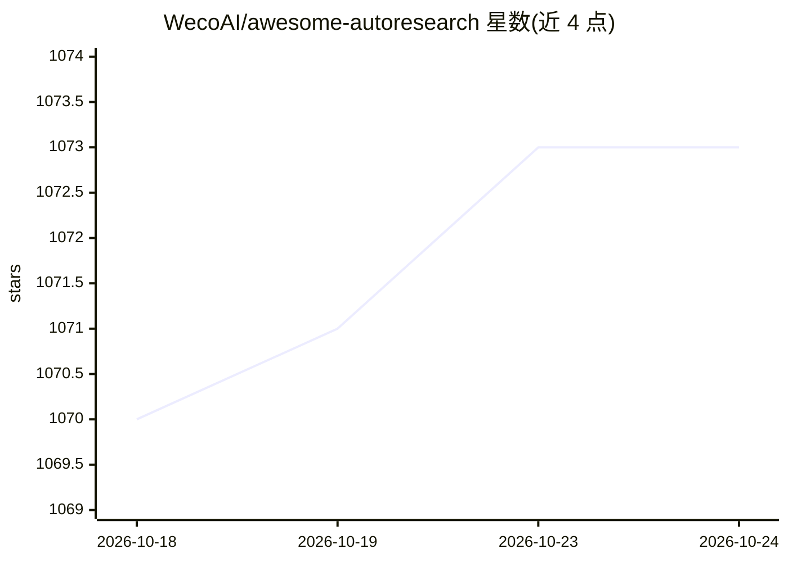

# WecoAI/awesome-autoresearch

⭐ 1,073 · CC0-1.0 · 推送 2026-07-30 · [GitHub](https://github.com/WecoAI/awesome-autoresearch) · 组织维护

**AutoResearch 用例策展清单：含优化轨迹与开源实现**

WecoAI 维护的 AutoResearch 用例聚合清单：AutoResearch 本身是一个由 Karpathy 发布的 program.md 提示词，指示编码 agent 对单文件做迭代优化（运行评估、按指标保留或回退改动）。清单收录 17 个社区用例（nanoGPT 训练优化、Shopify Liquid 模板引擎提速、CUDA 核优化、蛋白质折叠架构搜索等），每个条目附优化轨迹链接；另含 2 个评测基准与 12 个实现/分支（含 MLX、Windows RTX、分布式等移植）。

## 筛选速览

| 维度 | 判定 | 备注 |
|---|---|---|
| AI 角色 | `ai-knowledge` | 知识聚合/清单类 |
| 许可风险 | `viral` | CC0-1.0 |
| 部署形态 | `None` |  |
| 模型依赖 | — | README 未给出锁定关系 |
| 硬件要求 | — | 无带数字的原话,不猜 |
| 安装摩擦 | `medium` | 含编译或系统依赖之一 |
| 成熟度 | — | 结构信号不足 |

## 能力要点

- 17 个用例条目，每条附实际优化轨迹链接
- 收录 2 个评测基准（ResearchClawBench、FML-bench）
- 12 个实现与分支：MLX/Windows RTX/分布式/多 agent 等移植
- 核心机制为 keep/revert 循环：对单文件迭代优化并按评估指标取舍

## 适用场景

- 查找 AutoResearch 在训练优化、内核加速等任务上的实际效果与轨迹
- 选择适合自己硬件与场景的 autoresearch 实现或分支
- 了解该领域的评测基准与研究报告

## 场景标签

`精选清单` · 领域:学习与行业

## 证据(README 行号)

> L3: A curated list of AutoResearch use cases **with optimization traces** and open source implementations. Every entry i
> L7: AutoResearch is, at its core, a prompt. Karpathy released it as a single markdown file - `program.md`, that instruct

## 星数曲线

2026-10-18 1,070 → 2026-10-24 1,073（+3）

---
*卡片 v1 · prompt 1.4 · 生成 2026-10-21 · 置信度 high · 依据 README sha `c9f4ecf1002c` · [字段定义](../../DATASET.md)*
