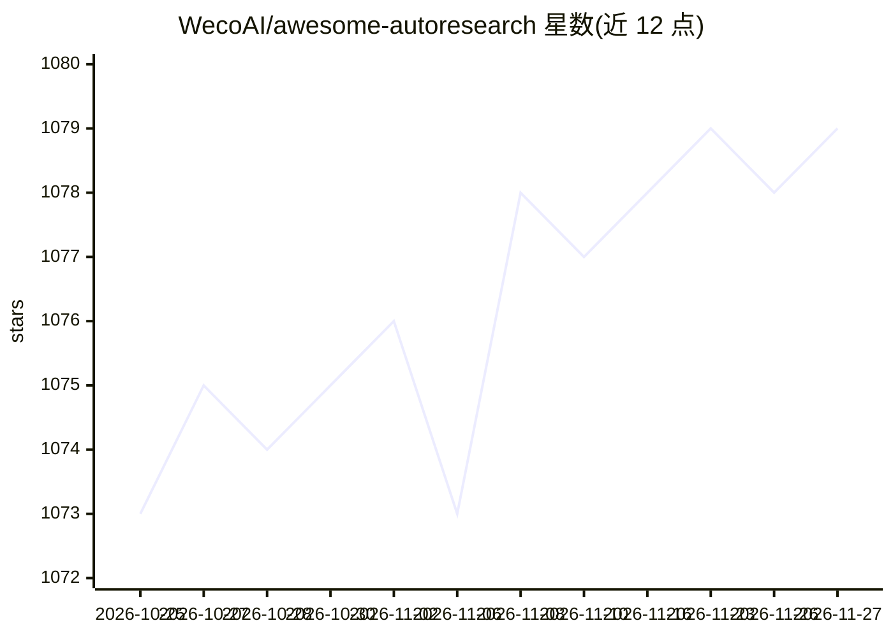

# WecoAI/awesome-autoresearch

⭐ 1,079 · CC0-1.0 · 推送 2026-11-21 · [GitHub](https://github.com/WecoAI/awesome-autoresearch) · 组织维护

**AutoResearch 应用案例与优化轨迹的开源实现策展清单**

由 Weco AI 维护的策展清单，收录 AutoResearch（源自 Karpathy 的 program.md 优化工作流：编码代理迭代编辑 train.py、按评估指标保留或回滚修改）的应用案例 19 项，每条附优化轨迹链接；另收录 3 个基准评测（ResearchClawBench、FML-bench、SciΠvot）和 16 个实现与分叉项目，涵盖 LLM 训练、GPU 内核、符号回归、量化 Alpha 等方向。README 本身不含安装与运行说明，License 为 CC0 1.0。

## 筛选速览

| 维度 | 判定 | 备注 |
|---|---|---|
| AI 角色 | `ai-knowledge` | 知识聚合/清单类 |
| 许可风险 | `viral` | CC0-1.0 |
| 部署形态 | `None` |  |
| 模型依赖 | — | README 未给出锁定关系 |
| 硬件要求 | — | 无带数字的原话,不猜 |
| 安装摩擦 | `medium` | 含编译或系统依赖之一 |
| 成熟度 | — | 结构信号不足 |

## 能力要点

- 19 个带优化轨迹链接的应用案例
- 收录 3 个 AI 研究代理基准评测
- 16 个实现/分叉项目（MLX、Windows RTX、分布式等移植）
- 由 Weco AI 维护，License 为 CC0 1.0

## 适用场景

- 查找 AutoResearch 在不同领域（GPU 内核、蛋白折叠、量化等）的落地案例与优化轨迹
- 为 AI 研究代理选择合适的基准评测
- 对比社区各种 AutoResearch 实现与分叉方案

## 场景标签

`精选清单` · 领域:学习与行业

## 证据(README 行号)

> L3: A curated list of AutoResearch use cases **with optimization traces** and open source implementations. Every entry i
> L42: ## Implementations & Forks

## 星数曲线

2026-10-25 1,073 → 2026-11-27 1,079（+6）

---
*卡片 v1 · prompt 1.4 · 生成 2026-11-24 · 置信度 high · 依据 README sha `3e299cc8a3e4` · [字段定义](../../DATASET.md)*
