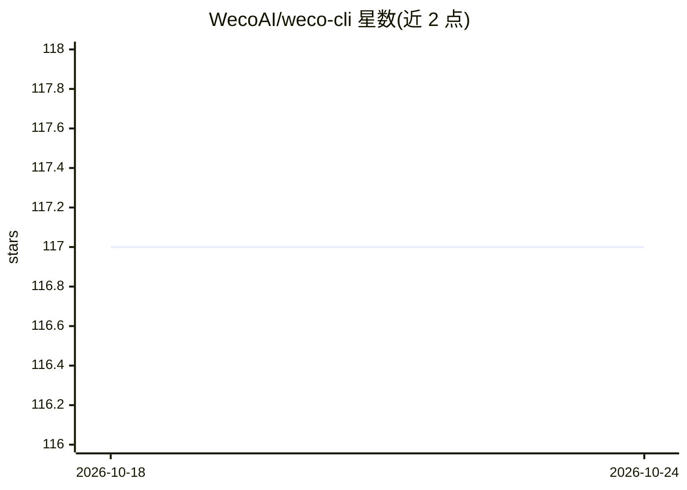

# WecoAI/weco-cli

⭐ 118 · Python · Apache-2.0 · 推送 2026-10-16 · [GitHub](https://github.com/WecoAI/weco-cli) · [官网](https://weco.ai) · 组织维护

**LLM 引导的代码自动优化 CLI，按评估指标迭代改进代码**

Weco CLI 通过 LLM 引导的树搜索迭代优化用户代码：自动应用改动、运行用户评估脚本、解析指标并提出下一步改进。适用场景包括 agent harness 工程、prompt 工程与压缩、ML 模型与训练管线调优、CUDA/Triton GPU 内核等可度量代码的性能优化。支持多文件联合优化、运行中断恢复、审查模式与 BYOK 多模型 API key；另有 weco observe 子命令将外部实验跟踪到 Weco 仪表盘，并以 skill 形式接入 Claude Code、Cursor、Codex、OpenClaw 等 AI 编码助手（实验性）。使用需登录 Weco 账户并按 credits 计费，README 注明当前不支持代码中的反引号。

## 筛选速览

| 维度 | 判定 | 备注 |
|---|---|---|
| AI 角色 | `ai-ecosystem` | LLM/agent 周边工具 |
| 许可风险 | `permissive` | Apache-2.0 |
| 部署形态 | `library` | 以包/库形式分发 |
| 模型依赖 | — | README 未给出锁定关系 |
| 硬件要求 | — | 无带数字的原话,不猜 |
| 安装摩擦 | `medium` | 含编译或系统依赖之一 |
| 成熟度 | `idea` | |

## 能力要点

- LLM 树搜索迭代优化：应用改动→运行评估→按指标继续改进
- 多文件联合优化与跨文件边界修改
- weco observe 跟踪外部实验到仪表盘（树可视化、代码 diff、指标）
- skill 形式接入 Claude Code / Cursor / Codex / OpenClaw

## 适用场景

- 优化 LLM agent 的 prompt、工具与脚手架
- 在保持精度的前提下压缩或精炼 prompt
- 调优 ML 特征变换、架构与训练管线
- 加速 CUDA / Triton GPU 内核等有可度量目标的代码

## 场景标签

`编码 Agent` · 领域:编码与开发

## 证据(README 行号)

> L15: Weco systematically optimizes your code, guided directly by your evaluation metrics.
> L28: The `weco` CLI leverages a tree search approach guided by LLMs to iteratively explore and refine your code. It auto
> L19: - **Agent & Harness Engineering**: Improve the harness around your LLM agents, from prompts and tools to agentic sc

## 星数曲线

2026-10-18 117 → 2026-10-24 117（+0）

---
*卡片 v1 · prompt 1.4 · 生成 2026-10-23 · 置信度 high · 依据 README sha `e7095694cda2` · [字段定义](../../DATASET.md)*
