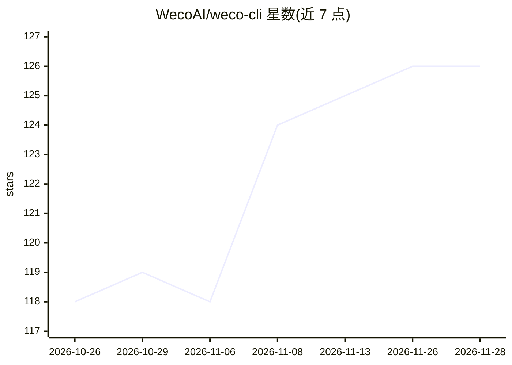

# WecoAI/weco-cli

⭐ 126 · Python · Apache-2.0 · 推送 2026-11-04 · [GitHub](https://github.com/WecoAI/weco-cli) · [官网](https://weco.ai) · 组织维护

**LLM 驱动的自动代码优化 CLI：按评估指标迭代改进代码**

weco 是一个命令行工具，用 LLM 引导的树搜索对用户代码做迭代优化：自动修改代码、运行用户的评估脚本、解析指标并继续提出改进。适用对象包括做 agent harness 工程与 prompt 工程的开发者、调 ML 训练管线的研究者、以及优化 CUDA/Triton kernel 等 GPU 代码的工程师。以 pip 包和安装脚本分发，可作为 skill 安装到 Claude Code/Cursor 等 AI 编码助手；`weco observe` 支持跟踪外部实验，提供 dashboard 与 Python SDK。

## 筛选速览

| 维度 | 判定 | 备注 |
|---|---|---|
| AI 角色 | `ai-ecosystem` | LLM/agent 周边工具 |
| 许可风险 | `permissive` | Apache-2.0 |
| 部署形态 | `library` | 以包/库形式分发 |
| 模型依赖 | — | README 未给出锁定关系 |
| 硬件要求 | — | 无带数字的原话,不猜 |
| 安装摩擦 | `medium` | 含编译或系统依赖之一 |
| 成熟度 | — | 结构信号不足 |

## 能力要点

- LLM 引导的树搜索迭代优化，自动运行评估并解析指标
- 作为 skill 安装到 Claude Code/Cursor/Codex/OpenClaw
- weco observe 以 JSON 输出跟踪外部优化实验，含树可视化和代码 diff
- 多文件同时优化与 BYOK 多 provider API key 配置

## 适用场景

- 优化 LLM agent 的 harness、工具与 scaffold 以提升 accuracy/win_rate
- 为数学问题等场景精炼或压缩 prompt 并保持准确率
- 调整特征变换、架构或整条训练管线以最大化验证指标
- 加速 CUDA/Triton GPU kernel 并优化 latency/throughput

## 场景标签

`编码 Agent` `提示工程` · 领域:Agent 开发

## 证据(README 行号)

> L15: Weco systematically optimizes your code, guided directly by your evaluation metrics.
> L28: The `weco` CLI leverages a tree search approach guided by LLMs to iteratively explore and refine your code. It auto
> L19: - **Agent & Harness Engineering**: Improve the harness around your LLM agents, from prompts and tools to agentic sc

## 星数曲线

2026-10-26 118 → 2026-11-28 126（+8）

---
*卡片 v1 · prompt 1.4 · 生成 2026-11-28 · 置信度 high · 依据 README sha `fe377483f427` · [字段定义](../../DATASET.md)*
