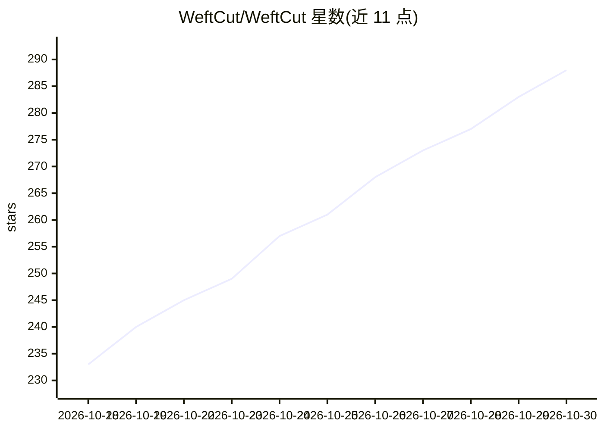

# WeftCut/WeftCut

⭐ 288 · TypeScript · MIT · 推送 2026-10-29 · [GitHub](https://github.com/WeftCut/WeftCut) · [官网](https://weftcut.com) · 个人维护 · 中文 README

**可被 AI agent 通过 MCP 操控的开源桌面视频编辑器**

面向 Windows/macOS/Linux 的完整桌面 NLE（多轨时间线、关键帧曲线编辑、字幕、基于角色的音频混音、硬件加速导出），核心机制是内置 localhost MCP 服务器，把全部编辑工具（place/trim/split/keyframe/caption/checkpoint 等）发布给 Codex、Claude 等 MCP 客户端驱动，支持多 agent 会话、dry_run 排练、检查点回滚、Tacks 审阅与 Timeline diff。Motif 机制让代码（HTML/CSS/WebGL）作为纯时间函数渲染成时间线图层。语音转写可选云端或本地引擎（whisper.cpp、FunASR），安装包不捆绑模型权重。作者声明仍在 v1.0.0 前活跃开发中。

## 筛选速览

| 维度 | 判定 | 备注 |
|---|---|---|
| AI 角色 | `ai-enhanced` | 去掉 AI 部分产品仍成立 |
| 许可风险 | `permissive` | MIT |
| 部署形态 | `desktop` | 安装包/桌面程序 |
| 模型依赖 | — | README 未给出锁定关系 |
| 硬件要求 | — | 无带数字的原话,不猜 |
| 安装摩擦 | `medium` | 含编译或系统依赖之一 |
| 成熟度 | `idea` | |

## 能力要点

- 内置 localhost MCP 服务器，发布全部编辑工具供任意 MCP 客户端调用
- 多 agent 会话、dry_run 排练、检查点一键恢复、Timeline diff 审阅
- Motif：以网页代码编写的时间线图层，按时间纯函数渲染，参数可在应用内编辑
- 本地语音转写可选 whisper.cpp / FunASR 按需下载，安装包不捆绑模型权重

## 适用场景

- 让 Claude/Codex 等 agent 直接在我正在观看的项目时间线上执行剪辑
- 用 agent 审查素材（镜头边界检测、停顿检测）并留 Tacks 供我决策
- 用代码编写倒计时、字幕条等动态叠加层并保持可编辑

## 场景标签

`图像视频处理` · 领域:感知与多模态

## 证据(README 行号)

> L27: Most editors bolt AI on as a feature: a button that generates something, a sidebar that suggests a cut. WeftCut exp
> L29: None of that rides on a stripped-down editor. Everything an agent can reach, you can do by hand, in a full NLE: A/B
> L6:  Point Codex, Claude, or any MCP client at a real desktop NLE — and watch

## 星数曲线

2026-10-18 233 → 2026-10-30 288（+55）

---
*卡片 v1 · prompt 1.4 · 生成 2026-10-22 · 置信度 high · 依据 README sha `53a2df03e418` · [字段定义](../../DATASET.md)*
