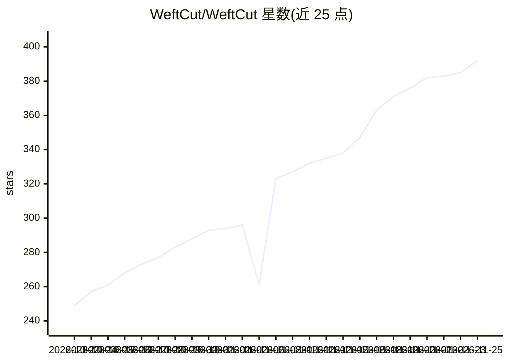

# WeftCut/WeftCut

⭐ 392 · TypeScript · MIT · 推送 2026-11-23 · [GitHub](https://github.com/WeftCut/WeftCut) · [官网](https://weftcut.com) · 个人维护

**可用 MCP 客户端驱动时间线的开源桌面视频编辑器**

基于 Electron 的跨平台非线编（NLE）应用，通过内置 localhost MCP server 将全部编辑工具（放置、裁剪、关键帧、字幕、混音等）暴露给 Codex、Claude 等 MCP 客户端，代理操作落入实时时间线并可撤销、可审计（Tacks 标注、Timeline diff、检查点）。同时是完整的手动编辑器：A/B-roll、曲线编辑器、角色混音、硬件加速导出。安装不带模型权重，语音/视觉本地引擎（whisper.cpp、FunASR）为可选下载，转录也可走云端。

## 筛选速览

| 维度 | 判定 | 备注 |
|---|---|---|
| AI 角色 | `ai-enhanced` | 去掉 AI 部分产品仍成立 |
| 许可风险 | `permissive` | MIT |
| 部署形态 | `desktop` | 安装包/桌面程序 |
| 模型依赖 | — | README 未给出锁定关系 |
| 硬件要求 | — | 无带数字的原话,不猜 |
| 安装摩擦 | `medium` | 含编译或系统依赖之一 |
| 成熟度 | `idea` | |

## 能力要点

- localhost MCP server 发布全部编辑工具，任何 MCP 客户端可驱动时间线
- Tacks 标注、Timeline diff 与检查点提供代理工作会话的审查与回滚机制
- Motif 机制：HTML/CSS/SVG/Canvas 编写的随时间纯函数渲染的屏幕元素层
- 代理与人工均可操作完整 NLE：A/B-roll、关键帧曲线、角色混音、H.264/HEVC/AV1 导出

## 适用场景

- 让代理按对话指令剪辑访谈素材并逐段审查后再落地
- 用代码生成下三分之一字幕条、倒计时等动态图层
- 本地或云端转录视频并生成可编辑字幕
- 手动完成完整剪辑流程，导出硬件加速视频

## 场景标签

`语音识别` `图像视频处理` · 领域:感知与多模态

## 证据(README 行号)

> L27: Most editors bolt AI on as a feature: a button that generates something, a sidebar that suggests a cut. WeftCut exp
> L29: None of that rides on a stripped-down editor. Everything an agent can reach, you can do by hand, in a full NLE: A/B
> L132: |**Agent surface**|MCP · streamable HTTP on localhost · stdio through the `weftcut` binary (Go, standard library o

## 星数曲线

2026-10-23 249 → 2026-11-25 392（+143）

---
*卡片 v1 · prompt 1.4 · 生成 2026-11-25 · 置信度 high · 依据 README sha `140d0776ecc4` · [字段定义](../../DATASET.md)*
