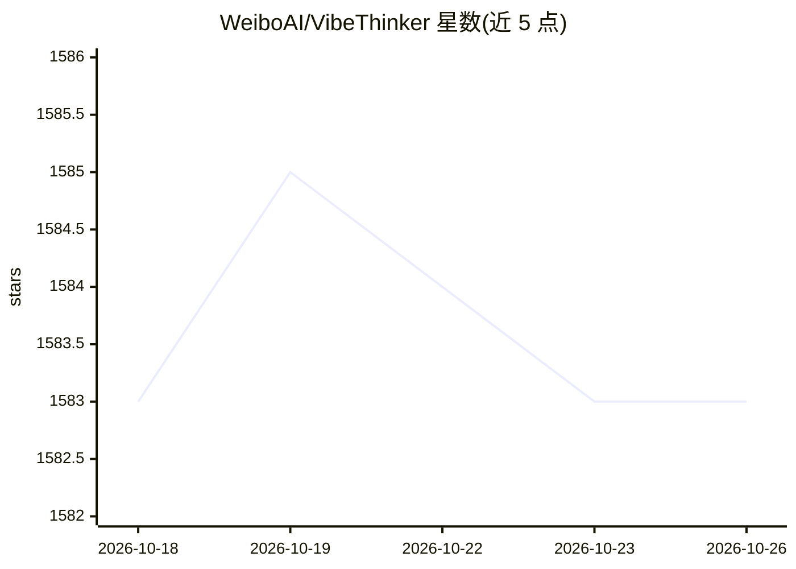

# WeiboAI/VibeThinker

⭐ 1,583 · Python · MIT · 推送 2026-08-14 · [GitHub](https://github.com/WeiboAI/VibeThinker) · 组织维护 · 中文 README

**小参数推理语言模型（1.5B/3B）及配套训练方法与评测资源**

WeiboAI（微博）发布的推理模型仓库，包含 VibeThinker-1.5B 与 3B 两个稠密模型权重（托管于 Hugging Face 与 ModelScope）。1.5B 版采用两阶段多样性探索蒸馏（SFT）与 MaxEnt-Guided Policy Optimization（RL）的后训练流程；3B 版基于 Qwen2.5-Coder-3B，加入多领域 RL、离线自蒸馏与 Claim-Level Reliability Assessment 测试时扩展策略。适用于答案可验证的数学、竞赛编程与 STEM 推理任务；README 声明不适合开放域知识任务。提供 transformers 代码示例、vLLM/SGLang 推荐配置与评测程序链接。

## 筛选速览

| 维度 | 判定 | 备注 |
|---|---|---|
| AI 角色 | `ai-native` | 本体是模型或模型工具 |
| 许可风险 | `permissive` | MIT |
| 部署形态 | `None` |  |
| 模型依赖 | local-ok | 支持本地模型 |
| 硬件要求 | — | 无带数字的原话,不猜 |
| 安装摩擦 | `low` | 无编译、无系统依赖或容器化 |
| 成熟度 | — | 结构信号不足 |

## 能力要点

- 1.5B/3B 稠密推理模型权重，托管于 Hugging Face 与 ModelScope
- 1.5B 采用 Spectrum-to-Signal 原则：多样性探索蒸馏 + MGPO 强化学习
- 3B 版引入 Claim-Level Reliability Assessment（CLR）测试时扩展策略
- 提供 transformers 快速上手示例与 vLLM/SGLang 推荐推理参数

## 适用场景

- 在数学竞赛与编程竞赛类可验证任务上运行小参数推理模型
- 复现技术报告中的 AIME/HMMT/LiveCodeBench 评测结果
- 研究低成本后训练方法（官方公布 1.5B 版后训练成本 $7,800）

## 场景标签

`强化学习` · 领域:训练与推理

## 证据(README 行号)

> L28: VibeThinker-3B is a 3-billion-parameter dense reasoning model developed to explore how far verifiable reasoning can
> L34: VibeThinker-1.5B is a 1.5B-parameter dense model that challenges the prevailing notion that small models inherently
> L64: - Hugging Face: WeiboAI/VibeThinker-3B

## 星数曲线

2026-10-18 1,583 → 2026-10-26 1,583（+0）

---
*卡片 v1 · prompt 1.4 · 生成 2026-10-21 · 置信度 high · 依据 README sha `1fe041f39d29` · [字段定义](../../DATASET.md)*
