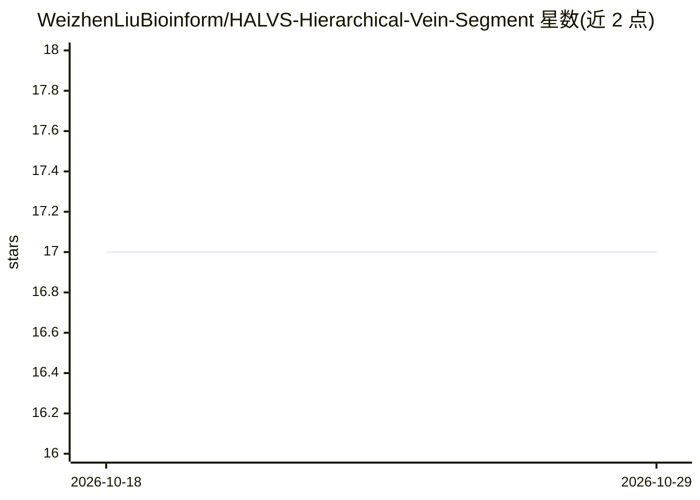

# WeizhenLiuBioinform/HALVS-Hierarchical-Vein-Segment

⭐ 17 · Python · 推送 2026-01-29 · [GitHub](https://github.com/WeizhenLiuBioinform/HALVS-Hierarchical-Vein-Segment) · 组织维护 · 中文 README

**叶脉层级分割数据集与半监督分割方法（IJCAI2024 论文）**

武汉理工大学等机构团队发布的论文配套仓库，包含 HALVS 数据集与代码：5,057 张大豆、甜樱桃、二球悬铃木的高分辨率叶片图像，带一级/二级/三级叶脉像素级标注，需签署用户协议邮件申请获取完整数据。方法上提出标签高效学习范式：仅标注一级与二级叶脉，通过半监督学习（PSSS 模块）推断三级叶脉分割；期刊扩展版新增基于扩散的 DDLR 模块与 clDice 指标。环境要求 Python 3.6-3.8、PyTorch 1.10+、Linux 系统，训练建议使用 GPU。

## 筛选速览

| 维度 | 判定 | 备注 |
|---|---|---|
| AI 角色 | `ai-native` | 本体是模型或模型工具 |
| 许可风险 | `none` | — |
| 部署形态 | `library` | 以包/库形式分发 |
| 模型依赖 | — | README 未给出锁定关系 |
| 硬件要求 | — | 无带数字的原话,不猜 |
| 安装摩擦 | `low` | 无编译、无系统依赖或容器化 |
| 成熟度 | — | 结构信号不足 |

## 能力要点

- 首个面向层级叶脉分割的公开数据集（5,057 张图像、3 个物种）
- 半监督学习范式：仅用一级/二级叶脉标注推断三级叶脉分割
- 期刊扩展版新增基于类加权扩散的 DDLR 模块与 clDice 指标
- 完整数据集需签署用户协议并通过邮件申请

## 适用场景

- 研究农业/植物科学中的层级叶脉结构分析
- 作为半监督/部分监督分割方法的基准数据集
- 植物育种相关表型研究的数据支撑

## 场景标签

`目标检测` · 领域:感知与多模态

## 证据(README 行号)

> L8: This repository contains the code and dataset for the paper "Revealing Hierarchical Structure of Leaf Venations in P
> L24: To address the challenge of label scarcity, the study proposes a label-efficient learning paradigm that leverages p

## 星数曲线

2026-10-18 17 → 2026-10-29 17（+0）

---
*卡片 v1 · prompt 1.4 · 生成 2026-10-29 · 置信度 mid · 依据 README sha `90ba6fa45027` · [字段定义](../../DATASET.md)*
