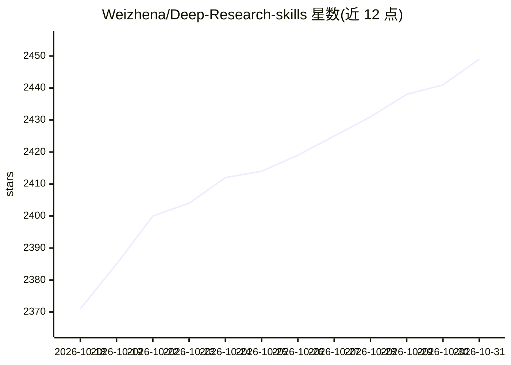

# Weizhena/Deep-Research-skills

⭐ 2,449 · Python · MIT · 推送 2026-08-23 · [GitHub](https://github.com/Weizhena/Deep-Research-skills) · 个人维护 · 中文 README

**面向 Claude Code/OpenCode/Codex 的结构化深度研究技能**

一套以技能（skills）形式安装到 Claude Code、OpenCode 与 Codex 的结构化深度研究工作流：两阶段流程，先 /research 生成可扩展的研究大纲（条目与字段），经人工确认或增补后用 /research-deep 对每个条目执行并行的网络深查，最后 /research-report 从 JSON 结果生成带目录的 Markdown 报告。人在回路设计允许在每个阶段控制输出。安装方式为 git clone 后复制技能文件到各工具目录；OpenCode 需设置 OPENCODE_ENABLE_EXA=1 才能启用 websearch；Codex 需修改 config.toml。中英双语版本可选。

## 筛选速览

| 维度 | 判定 | 备注 |
|---|---|---|
| AI 角色 | `ai-ecosystem` | LLM/agent 周边工具 |
| 许可风险 | `permissive` | MIT |
| 部署形态 | `None` |  |
| 模型依赖 | locked-api |  |
| 硬件要求 | — | 无带数字的原话,不猜 |
| 安装摩擦 | `low` | 无编译、无系统依赖或容器化 |
| 成熟度 | — | 结构信号不足 |

## 能力要点

- 两阶段研究流程：大纲生成（可增补条目/字段）+ 逐项深度调查
- 5 个斜杠命令：/research、/research-add-items、/research-add-fields、/research-deep、/research-report
- 支持 Claude Code、OpenCode、Codex 三个 agent 工具，含中英文技能版本
- 从 JSON 结果自动生成带目录的 Markdown 报告

## 适用场景

- 论文综述、基准评测与文献分析等学术研究
- 技术选型与框架对比调研
- 竞品分析、行业趋势与尽调研究
- 让 AI agent 按可控大纲批量收集信息并产出结构化报告

## 场景标签

`科研工具` · 领域:学习与行业

## 证据(README 行号)

> L9: A structured research workflow skill for Claude Code, OpenCode, and Codex, supporting two-phase research: outline ge
> L27: ### Claude Code
> L45: ### Codex

## 星数曲线

2026-10-18 2,371 → 2026-10-31 2,449（+78）

---
*卡片 v1 · prompt 1.4 · 生成 2026-10-21 · 置信度 high · 依据 README sha `57349866cf3a` · [字段定义](../../DATASET.md)*
