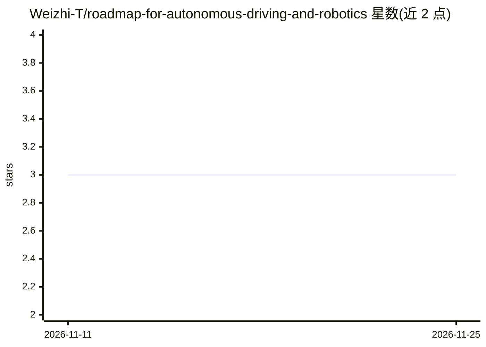

# Weizhi-T/roadmap-for-autonomous-driving-and-robotics

⭐ 3 · HTML · 推送 2026-11-15 · [GitHub](https://github.com/Weizhi-T/roadmap-for-autonomous-driving-and-robotics) · [官网](https://weizhi-t.github.io/roadmap-for-autonomous-driving-and-robotics/) · 个人维护 · 中文 README

**给自动驾驶与机器人研究者用的双语交互知识地图**

一个中英双语静态网站，以交互地图形式组织自动驾驶与机器人领域的研究脉络，覆盖数据、训练、决策、控制到反馈的链路；提供按阶段与方法浏览的全景图、收录论文/作者项目/代码/文档的参考文献库，以及研究导读栏目。支持中英切换、按领域筛选与搜索。深度思考课题、arXiv 文章、算法原理与项目复现栏目仍在建设中尚未发布内容。克隆仓库后用本地 HTTP 服务即可运行。

## 筛选速览

| 维度 | 判定 | 备注 |
|---|---|---|
| AI 角色 | `ai-knowledge` | 知识聚合/清单类 |
| 许可风险 | `none` | — |
| 部署形态 | `None` |  |
| 模型依赖 | — | README 未给出锁定关系 |
| 硬件要求 | — | 无带数字的原话,不猜 |
| 安装摩擦 | `low` | 无编译、无系统依赖或容器化 |
| 成熟度 | `idea` | |

## 能力要点

- 中英双语交互知识地图，覆盖数据到反馈的完整链路
- 参考文献库收录论文、作者项目、代码与官方文档
- 支持语言切换、领域筛选与搜索定位
- 纯静态站点，克隆仓库即可本地运行

## 适用场景

- 按研究阶段梳理自动驾驶与机器人的技术脉络
- 查找某个研究方向的论文与代码资料
- 中英对照阅读领域研究背景

## 场景标签

`科研工具` `教程课程` · 领域:学习与行业

## 证据(README 行号)

> L3: An interactive, bilingual knowledge map connecting research across autonomous driving and robotics, from data and tr
> L11: - **Interactive atlas / 交互全景图:** Browse the research map by stage and method, then follow nodes to explanations and
> L15: The research questions, arXiv, algorithm principles, and project reproduction sections are planned and do not yet c

## 星数曲线

2026-11-11 3 → 2026-11-25 3（+0）

---
*卡片 v1 · prompt 1.4 · 生成 2026-11-22 · 置信度 high · 依据 README sha `5313f24d347a` · [字段定义](../../DATASET.md)*
