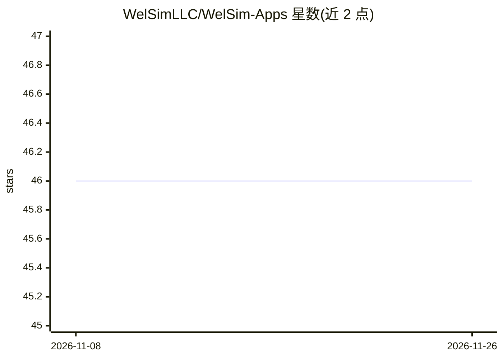

# WelSimLLC/WelSim-Apps

⭐ 46 · C++ · 推送 2026-11-11 · [GitHub](https://github.com/WelSimLLC/WelSim-Apps) · [官网](https://welsim.com) · 组织维护

**工程仿真公司旗下的免费工程小工具合集仓库**

WelSim 公司维护的应用集合仓库：除旗舰有限元分析软件 WELSIM 外，提供免费的材料编辑查看工具 MatEditor、非线性曲线拟合工具 CurveFitter、单位换算工具 UnitConverter 以及梁截面属性计算器 BeamSection，面向研究人员与工程师。README 仅作简要介绍并引导至 Issues/Discussions 与邮件联系，未给出安装命令或运行说明。

## 筛选速览

| 维度 | 判定 | 备注 |
|---|---|---|
| AI 角色 | `ai-enhanced` | 去掉 AI 部分产品仍成立 |
| 许可风险 | `none` | — |
| 部署形态 | `None` |  |
| 模型依赖 | — | README 未给出锁定关系 |
| 硬件要求 | — | 无带数字的原话,不猜 |
| 安装摩擦 | `low` | 无编译、无系统依赖或容器化 |
| 成熟度 | — | 结构信号不足 |

## 能力要点

- 包含 MatEditor、CurveFitter、UnitConverter、BeamSection 四款免费工程应用
- 母产品 WELSIM 为通用仿真求解器 GUI
- 通过 GitHub Issues/Discussions 与邮件提供支持渠道

## 适用场景

- 编辑和查看工程材料数据
- 对实验数据做非线性曲线拟合
- 工程单位换算与梁截面属性计算

## 场景标签

 · 领域:工程仿真/CAE

## 证据(README 行号)

> L5: In addtion to the flagship finite element analysis software **WELSIM**, We also developed free engineering applicati

## 星数曲线

2026-11-08 46 → 2026-11-26 46（+0）

---
*卡片 v1 · prompt 1.4 · 生成 2026-11-18 · 置信度 low · 依据 README sha `0175e9035dd8` · [字段定义](../../DATASET.md)*
