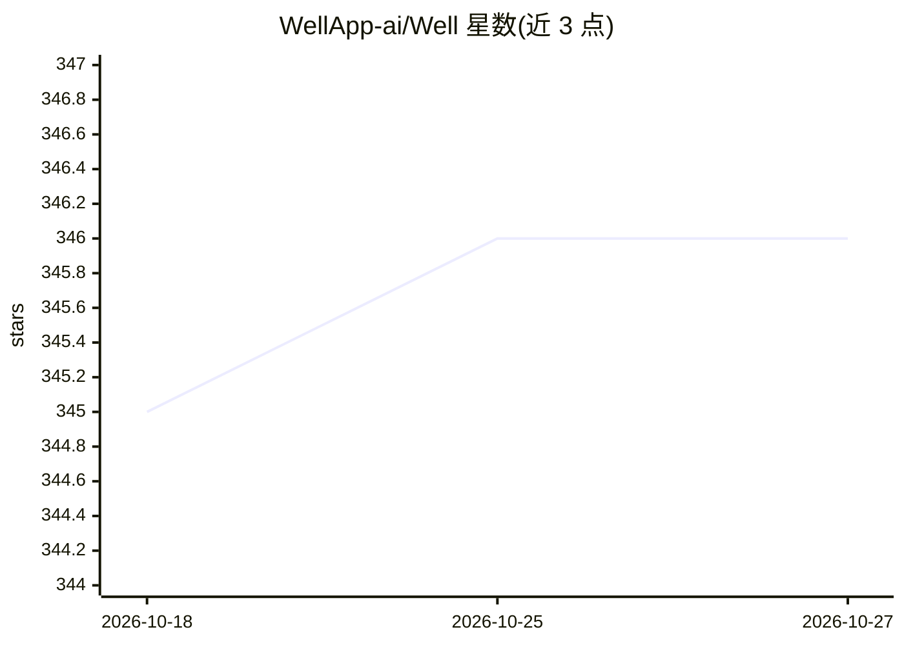

# WellApp-ai/Well

⭐ 346 · TypeScript · MIT · 推送 2026-10-23 · [GitHub](https://github.com/WellApp-ai/Well) · [官网](https://wellapp.ai/) · 组织维护

**自动抓取供应商发票并接入记账系统的 Chrome 扩展**

面向创始人、个体经营者和小型团队的 Chrome 扩展：自动化浏览器工作流以批量抓取 10 万+ 网络门户的供应商发票，支持 Gmail、WhatsApp、Google Drive、Slack 等多渠道采集，并将数据以 JSON/CSV/XML/UBL/QuickBooks/Xero 等格式导出至记账工具、ERP 或仪表盘。AI 用于生成工作流蓝图、浏览时自动建议抓取及供应商界面变更后的自愈；另提供 MCP 接口供 Claude、Cursor 等 AI 客户端查询发票数据。不存储密码，声明符合 GDPR/CCPA。

## 筛选速览

| 维度 | 判定 | 备注 |
|---|---|---|
| AI 角色 | `ai-enhanced` | 去掉 AI 部分产品仍成立 |
| 许可风险 | `permissive` | MIT |
| 部署形态 | `None` |  |
| 模型依赖 | — | README 未给出锁定关系 |
| 硬件要求 | — | 无带数字的原话,不猜 |
| 安装摩擦 | `low` | 无编译、无系统依赖或容器化 |
| 成熟度 | — | 结构信号不足 |

## 能力要点

- 覆盖 100,000+ 网络门户的发票自动抓取
- 多渠道采集：Gmail、WhatsApp、PDF、Google Drive、Slack
- 6 种导出格式（JSON/CSV/XML/UBL/QuickBooks/Xero）
- MCP 集成与 Claude Code 一键插件（含财务技能）

## 适用场景

- 报税季批量从多个门户拉取发票，省去重复点击与复制粘贴
- 浏览网页时自动检测并抓取已支付发票
- 让 AI 助手通过 MCP 直接查询发票、公司与交易数据
- 月末结账时快速汇总 50+ 张发票

## 场景标签

`浏览器自动化` · 领域:效率与自动化

## 证据(README 行号)

> L19: At its core, Well is a **Chrome extension** that automates browser workflows on your behalf — boosting productivity
> L24: - AI-generated workflow blueprints
> L110:  Well's AI suggests retrieval when it sees a paid invoice.

## 星数曲线

2026-10-18 345 → 2026-10-27 346（+1）

---
*卡片 v1 · prompt 1.4 · 生成 2026-10-21 · 置信度 high · 依据 README sha `7c1a27bc87ac` · [字段定义](../../DATASET.md)*
