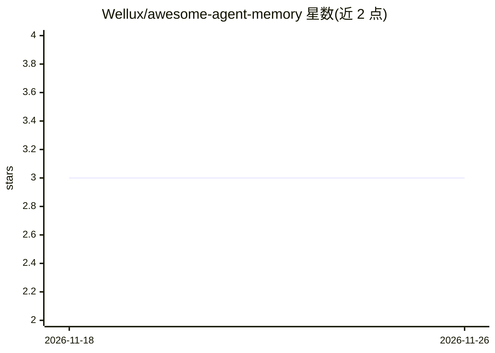

# Wellux/awesome-agent-memory

⭐ 3 · CC0-1.0 · 推送 2026-11-16 · [GitHub](https://github.com/Wellux/awesome-agent-memory) · [官网](https://well-ux.com) · 个人维护

**Agent 记忆相关仓库精选清单：312 个项目按任务分类**

一份 curated 清单，收录 312 个与 agent 记忆相关的仓库，来自 6,600+ star 项目的筛选，按 6 个类别组织：记忆层服务、编码 agent 记忆、RAG 引擎、向量数据库、文档解析与 OCR、知识应用等。每个条目附一句话用途说明与 star 数；设 4 个起步推荐（按 Parse/Retrieve/Remember/Research 角色）、每周新增栏目与 CONTRIBUTING 提交入口。清单本身以 CC0 许可发布，无安装步骤，使用方式是阅读并跳转各仓库。

## 筛选速览

| 维度 | 判定 | 备注 |
|---|---|---|
| AI 角色 | `ai-knowledge` | 知识聚合/清单类 |
| 许可风险 | `viral` | CC0-1.0 |
| 部署形态 | `None` |  |
| 模型依赖 | — | README 未给出锁定关系 |
| 硬件要求 | — | 无带数字的原话,不猜 |
| 安装摩擦 | `low` | 无编译、无系统依赖或容器化 |
| 成熟度 | — | 结构信号不足 |

## 能力要点

- 312 个仓库、6 类分类、每条一句话用途描述
- 按角色提供 4 个起步推荐（docling/ragflow/mem0/gpt-researcher）
- 每周更新栏目列出近 7 天收录项目
- CC0 许可，接受社区通过 CONTRIBUTING 提交

## 适用场景

- 为 agent 项目挑选记忆层或 RAG 引擎时按任务浏览候选
- 了解 agent memory 生态中各仓库的定位与热度
- 想提交新仓库到该清单

## 场景标签

`精选清单` `Agent 记忆` · 领域:Agent 开发

## 证据(README 行号)

> L1: Awesome Agent Memory: Memory layers, RAG, vector search, document parsing, second brains and research agents, so age
> L7: Everything that lets agents remember and look things up: memory layers, coding-agent memory, RAG engines, vector dat
> L14: 2. **Rubrik.** Unter Contents die Rubrik wählen: jedes Repo steht genau einmal da, nach der Aufgabe, die es erledig

## 星数曲线

2026-11-18 3 → 2026-11-26 3（+0）

---
*卡片 v1 · prompt 1.4 · 生成 2026-11-22 · 置信度 high · 依据 README sha `c198d324db3c` · [字段定义](../../DATASET.md)*
