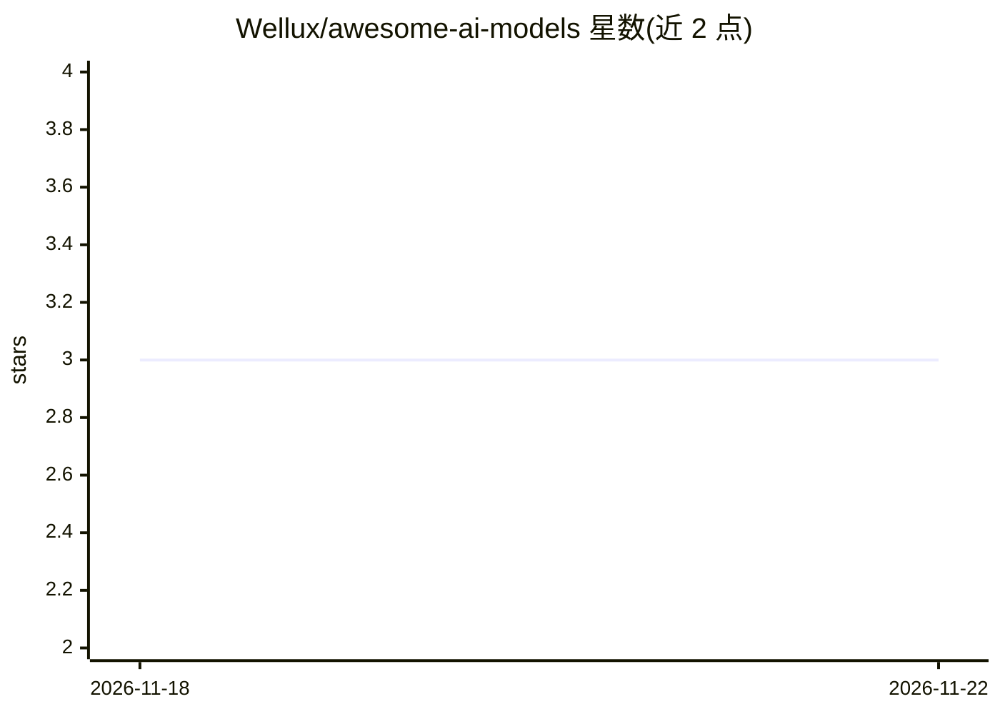

# Wellux/awesome-ai-models

⭐ 3 · CC0-1.0 · 推送 2026-11-16 · [GitHub](https://github.com/Wellux/awesome-ai-models) · [官网](https://well-ux.com) · 组织维护

**AI 模型运行/路由/训练工具的 awesome 精选清单（625 仓库 12 类）**

一份按使用任务组织的 awesome 精选清单，收录 625 个仓库、分 12 个类别，覆盖本地推理引擎、网关与模型路由、开源与决策模型、微调与效率工具、SDK，以及计算机视觉、3D、视频理解、机器人与机器学习基础。每条以一句话说明用途并标注星数，提供 4 个按角色（运行/路由/微调/学习）划分的起步推荐，按周更新新增条目，收录标准为公开、有许可证且当前可运行，通过 CONTRIBUTING.md 接受提议。

## 筛选速览

| 维度 | 判定 | 备注 |
|---|---|---|
| AI 角色 | `ai-knowledge` | 知识聚合/清单类 |
| 许可风险 | `viral` | CC0-1.0 |
| 部署形态 | `None` |  |
| 模型依赖 | — | README 未给出锁定关系 |
| 硬件要求 | — | 无带数字的原话,不猜 |
| 安装摩擦 | `medium` | 含编译或系统依赖之一 |
| 成熟度 | — | 结构信号不足 |

## 能力要点

- 625 个仓库按使用任务分 12 类组织
- 每条目含一句话用途说明与星数标注
- Start here 提供 Run/Route/Fine-tune/Learn 四个角色各一个起步推荐
- 每周列出近七天新收录条目

## 适用场景

- 为本地运行开源模型寻找推理引擎或运行时
- 挑选 LLM 网关与模型路由方案
- 查找模型微调、量化与设备端部署工具
- 按任务浏览 CV、机器人、具身 AI 相关仓库

## 场景标签

`精选清单` · 领域:学习与行业

## 证据(README 行号)

> L1: Awesome AI Models: Run, route, train and study AI models: local inference, gateways, open models, decision models, v
> L7: Everything below the agent: local inference engines, gateways and model routers, open and decision models, fine-tuni
> L76: ## Contents

## 星数曲线

2026-11-18 3 → 2026-11-22 3（+0）

---
*卡片 v1 · prompt 1.4 · 生成 2026-11-22 · 置信度 high · 依据 README sha `06d31e8df930` · [字段定义](../../DATASET.md)*
