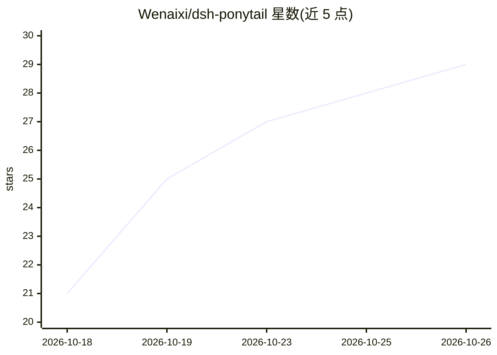

# Wenaixi/dsh-ponytail

⭐ 29 · JavaScript · MIT · 推送 2026-10-24 · [GitHub](https://github.com/Wenaixi/dsh-ponytail) · [官网](https://www.npmjs.com/package/@wenaixi/dsh-ponytail) · 个人维护 · 中文 README

**DeepSeek Harness 插件：注入懒人 senior 模式与七阶梯提示词**

面向 DeepSeek Harness（DSH）运行时的 Cordis 插件，独立移植自 DietrichGebert/ponytail v4.10.3。将七阶梯系统提示注入 system prompt，提供 6 个技能（模式切换、删除式代码审查、全仓复杂度审计、技术债台账、缩减指标看板、帮助卡），零 tool 注册。采用 Zero Cache Miss 架构：切换强度通过回合末 system-reminder 生效，保持系统提示基线字节不变。技能描述中英双语可切换，各技能独立开关，按 profile 目录隔离多实例。

## 筛选速览

| 维度 | 判定 | 备注 |
|---|---|---|
| AI 角色 | `ai-ecosystem` | LLM/agent 周边工具 |
| 许可风险 | `permissive` | MIT |
| 部署形态 | `library` | 以包/库形式分发 |
| 模型依赖 | — | README 未给出锁定关系 |
| 硬件要求 | — | 无带数字的原话,不猜 |
| 安装摩擦 | `low` | 无编译、无系统依赖或容器化 |
| 成熟度 | — | 结构信号不足 |

## 能力要点

- 七阶梯系统提示注入，零 tool 注册
- Zero Cache Miss 架构：切换强度不触碰历史 KV/Prompt Cache
- 6 个技能含独立开关与中英双语描述切换
- 配置按 profile 目录隔离，卸载后不残留文件

## 适用场景

- 在 DSH 中约束 agent 避免过度工程、优先删除代码
- 对整个仓库做复杂度审计与技术债台账
- 长会话中切换提示强度而不破坏缓存

## 场景标签

`提示工程` `代码审查` · 领域:Agent 开发

## 证据(README 行号)

> L14: A DeepSeek Harness (DSH) port of DietrichGebert/ponytail, maintained independently (ADR-0010). Injects the 7-rung l
> L20: Features a **Zero Cache Miss Architecture** (ADR-0012): session baseline is locked permanently, and dynamic intensi
> L86: The six hooks from upstream `hooks/` are consolidated into a single DSH Cordis plugin:

## 星数曲线

2026-10-18 21 → 2026-10-26 29（+8）

---
*卡片 v1 · prompt 1.4 · 生成 2026-10-26 · 置信度 high · 依据 README sha `9a6cef2af7aa` · [字段定义](../../DATASET.md)*
