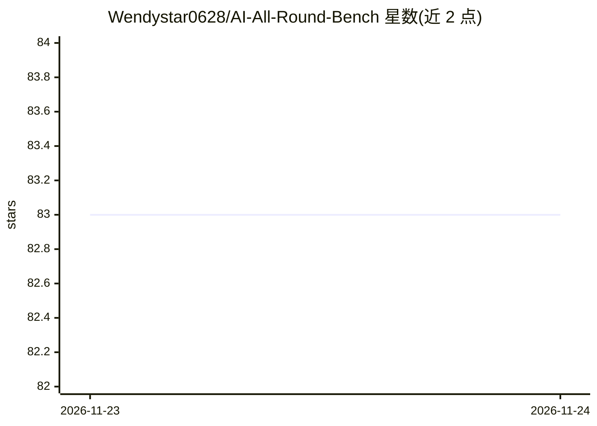

# Wendystar0628/AI-All-Round-Bench

⭐ 83 · JavaScript · MIT · 推送 2026-11-22 · [GitHub](https://github.com/Wendystar0628/AI-All-Round-Bench) · [官网](https://octathlon.wendystars.com/) · 个人维护 · 中文 README

**给 AI 编程智能体出的限时挑战测评平台与榜单**

面向 AI 编程智能体的限时挑战测评：平台负责计时、会话隔离、中断叫回、续做与评分调度，每个专题自带题目、评分方式与网页。已上线专题「AI十项全能」含 13 题共 10 类（Lean 证明、竞赛数学、CUDA/CPU 优化、算法对抗、3D/网页应用、嵌套操作系统等），每题限时 60–100 分钟，无人答疑、到时中止，评分由程序校验与 AI 评分员结合。仓库公开题面、评分指南、参测名单与提交物档案；调度程序与作答目录在测试机本地，不在仓库中。

## 筛选速览

| 维度 | 判定 | 备注 |
|---|---|---|
| AI 角色 | `ai-ecosystem` | LLM/agent 周边工具 |
| 许可风险 | `permissive` | MIT |
| 部署形态 | `None` |  |
| 模型依赖 | — | README 未给出锁定关系 |
| 硬件要求 | — | 无带数字的原话,不猜 |
| 安装摩擦 | `medium` | 含编译或系统依赖之一 |
| 成熟度 | — | 结构信号不足 |

## 能力要点

- 13 题 10 类限时挑战，每题 60–100 分钟、无人协助独立作答
- 平台机制覆盖计时、隔离、叫回、故障续做与公平批次调度
- 评分混合程序校验与 AI 评分员，按权重合成总分与排行
- 题面、评分指南、参测名单与逐文件 SHA256 提交档案公开

## 适用场景

- 查看各模型在编程智能体任务上的分项得分与排行
- 按公开题面与评分指南复现或研究测评题目
- 了解限时隔离测评的调度与续做机制设计

## 场景标签

`模型评测` · 领域:评测与运维

## 证据(README 行号)

> L7:  给 AI 编程智能体出的限时挑战测评。平台管计时、隔离、叫回、续做和评分调度；每个专题有自己的题目、评法和网页。
> L15: - **怎么评**：按专题的评分指南，能算的由程序算，其余由 AI 评分员打分；再按专题的权重合成总分并排行。

## 星数曲线

2026-11-23 83 → 2026-11-24 83（+0）

---
*卡片 v1 · prompt 1.4 · 生成 2026-11-24 · 置信度 high · 依据 README sha `ec088589b085` · [字段定义](../../DATASET.md)*
