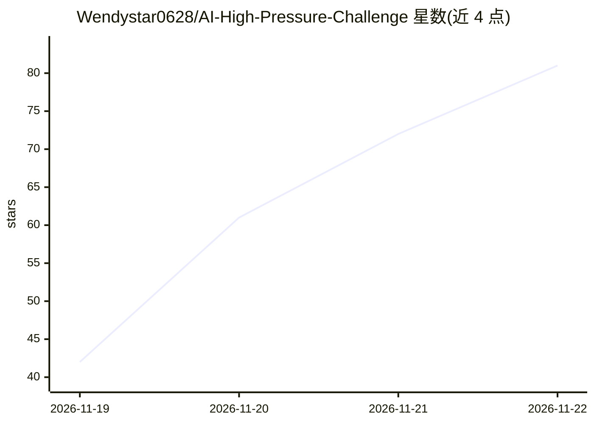

# Wendystar0628/AI-High-Pressure-Challenge

⭐ — · [GitHub]() · 个人维护 · 中文 README

**面向 AI 编程智能体的限时评测基准：10 类 13 题**

一套给 AI 编程智能体做的定时评测基准，含 13 道题、10 个类别：Lean 形式化证明、竞赛数学、CUDA/CPU 性能优化、对战程序、鲁班锁拆解、工程图几何建模、网页/桌面应用开发等，每题限时 60–100 分钟且无人工协助。主动设计题由 Claude Opus 5.5 与 GPT 6.1 Sol 双评取平均，标准评判题由程序校验评分，结果发布在在线排行榜。题目面与评分规则在 README 中完整给出。

## 筛选速览

| 维度 | 判定 | 备注 |
|---|---|---|
| AI 角色 | `ai-knowledge` | 知识聚合/清单类 |
| 许可风险 | `none` | — |
| 部署形态 | `None` |  |
| 模型依赖 | — | README 未给出锁定关系 |
| 硬件要求 | — | 无带数字的原话,不猜 |
| 安装摩擦 | `medium` | 含编译或系统依赖之一 |
| 成熟度 | — | 结构信号不足 |

## 能力要点

- 13 道题覆盖 10 个类别，每题限时 60–100 分钟独立作答
- 主动设计题由 Claude Opus 5.5 和 GPT 6.1 Sol 各评一次取平均
- 标准评判题由程序校验生成 scores（编译、加速比、Elo 实力值等）
- 在线排行榜 octathlon.wendystars.com

## 适用场景

- 在统一题集与限时条件下评测 AI 编程智能体的能力
- 对比不同模型在数学证明、性能优化与前端开发任务上的得分
- 为智能体排行榜提供可复现的计分数据

## 场景标签

`模型评测` · 领域:评测与运维

## 证据(README 行号)

> L13: - **是什么**：给 AI 编程智能体做的限时评测。题目从 Lean 形式化证明、竞赛数学、性能优化、鲁班锁拆解和机械结构重建，一直到整件网页作品和桌面系统的设计与开发。
> L14: - **测谁**：模型连同它自己的智能体工具一起测，例如 Claude Code、Codex，推理强度默认 `xhigh`。
> L17: - **谁来评**：主动设计题由 Claude Opus 5.5 和 GPT 6.1 Sol 各评一次、取平均；标准评判题由程序校验生成分数。

## 星数曲线

2026-11-19 42 → 2026-11-22 81（+39）

---
*卡片 v1 · prompt 1.4 · 生成 2026-11-19 · 置信度 high · 依据 README sha `57067442c31b` · [字段定义](../../DATASET.md)*
