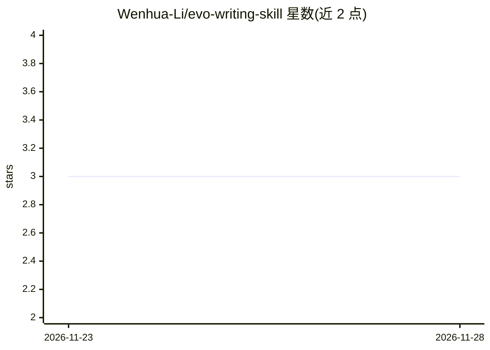

# Wenhua-Li/evo-writing-skill

⭐ 3 · Python · MIT · 推送 2026-11-23 · [GitHub](https://github.com/Wenhua-Li/evo-writing-skill) · [官网](https://wenhua-li.github.io/evo-writing-skill/) · 个人维护 · 中文 README

**进化计算论文写作的 Agent 技能：去除 AI 腔与防御性表述**

以 Agent Skills 形式安装的写作技能，基于 1,517 篇 TEVC 论文（1997–2023）语料与 150 篇分层审阅提炼。核心机制：从研究含义出发重写段落、硬性语言门禁拦截被禁词汇与套路对比句式、保留引文/数值/定理条件等科学含义、可选用审计模式标记无依据的声明。提供 npx、shell 脚本与 PowerShell 三种安装方式，附 Python 标准库实现的文本检查脚本。局限：不保证发表，语料仅覆盖 TEVC。

## 筛选速览

| 维度 | 判定 | 备注 |
|---|---|---|
| AI 角色 | `ai-native` | 本体是模型或模型工具 |
| 许可风险 | `permissive` | MIT |
| 部署形态 | `library` | 以包/库形式分发 |
| 模型依赖 | — | README 未给出锁定关系 |
| 硬件要求 | — | 无带数字的原话,不猜 |
| 安装摩擦 | `low` | 无编译、无系统依赖或容器化 |
| 成熟度 | — | 结构信号不足 |

## 能力要点

- 基于 1,517 篇 TEVC 论文语料的领域化改写规则
- 硬性语言门禁：被禁词汇命中即要求重写，含技术例外保护
- 保留引用、DOI、数值结果与基准名等科学含义
- 审计模式标记无统计检验、无保证的过强声明

## 适用场景

- 改写进化计算论文中被审稿人识别为 AI 生成风格的段落
- 投稿前检查论文中的防御性措辞与无依据声明
- 按作者写作样本匹配个人文风

## 场景标签

`AI 写作` `科研工具` · 领域:内容生成

## 证据(README 行号)

> L7: Distilled from **1,517 TEVC papers (1997–2023)** and a stratified review of 150 papers. EvoWrite rebuilds AI-soundin
> L60: Use evo-write. Rewrite this introduction to remove AI tells and defensive writing.
> L108: python tools/scripts/check_prose.py -

## 星数曲线

2026-11-23 3 → 2026-11-28 3（+0）

---
*卡片 v1 · prompt 1.4 · 生成 2026-11-23 · 置信度 high · 依据 README sha `f36d1fb8acc4` · [字段定义](../../DATASET.md)*
