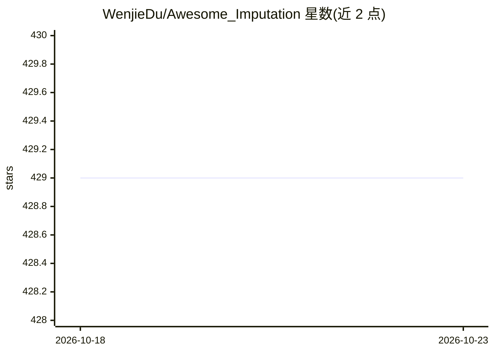

# WenjieDu/Awesome_Imputation

⭐ 429 · Python · BSD-3-Clause · 推送 2026-08-03 · [GitHub](https://github.com/WenjieDu/Awesome_Imputation) · 个人维护

**时间序列插补论文与工具清单，附 TSI-Bench 基准复现代码**

由 PyPOTS Research 维护的时间序列插补资源仓库：收录 2016-2025 年发表于 ICML/NeurIPS/ICLR/KDD 等会议期刊的必读论文条目（含论文与官方代码链接），并整理 PyPOTS、TSDB、BenchPOTS、PyGrinder、MICE 等插补相关工具箱。仓库同时是论文 TSI-Bench: Benchmarking Time Series Imputation 的载体，benchmark_code 文件夹提供复现实验结果的代码与配置。面向时间序列插补领域的研究者与从业者，接受社区贡献更新条目。

## 筛选速览

| 维度 | 判定 | 备注 |
|---|---|---|
| AI 角色 | `ai-knowledge` | 知识聚合/清单类 |
| 许可风险 | `permissive` | BSD-3-Clause |
| 部署形态 | `None` |  |
| 模型依赖 | — | README 未给出锁定关系 |
| 硬件要求 | — | 无带数字的原话,不猜 |
| 安装摩擦 | `low` | 无编译、无系统依赖或容器化 |
| 成熟度 | — | 结构信号不足 |

## 能力要点

- 按年份（2016-2025）组织的必读论文清单，附论文与官方代码链接
- 整理 PyPOTS 生态工具箱（TSDB 172 数据集加载、BenchPOTS 预处理、PyGrinder 缺失模拟）
- 提供 TSI-Bench 基准论文的实验复现代码与配置
- 标注已验证并集成进 PyPOTS 的模型条目

## 适用场景

- 查找时间序列插补领域的必读论文与官方实现
- 为插补研究选择数据集、预处理与缺失模式模拟工具
- 复现 TSI-Bench 论文的基准实验结果

## 场景标签

`精选清单` `模型评测` · 领域:评测与运维

## 证据(README 行号)

> L9: The repository for the paper **TSI-Bench: Benchmarking Time Series Imputation**
> L12: The README file here maintains a list of must-read papers on time-series imputation, and a collection of time-serie

## 星数曲线

2026-10-18 429 → 2026-10-23 429（+0）

---
*卡片 v1 · prompt 1.4 · 生成 2026-10-21 · 置信度 high · 依据 README sha `111dbcf75acd` · [字段定义](../../DATASET.md)*
