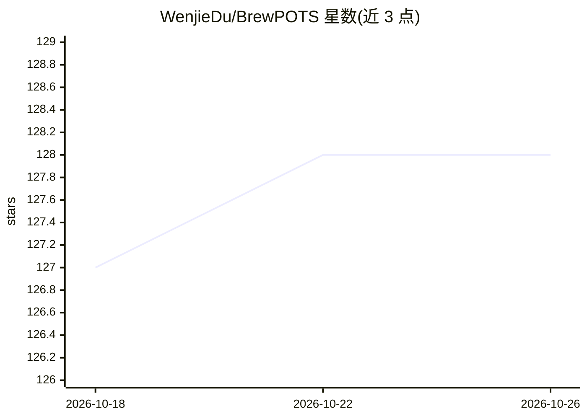

# WenjieDu/BrewPOTS

⭐ 128 · Jupyter Notebook · BSD-3-Clause · 推送 2026-08-25 · [GitHub](https://github.com/WenjieDu/BrewPOTS) · [官网](https://pypots.com) · 个人维护

**PyPOTS 的使用教程集：部分观测时间序列数据挖掘上手指南**

PyPOTS 库的配套教程仓库，以'咖啡豆（POTS 数据）用咖啡壶（PyPOTS）煮成咖啡'的比喻组织内容，指导用户对部分观测/含缺失值的时间序列数据做填补、分类、聚类、预测等任务。教程面向快速上手实践，未做超参数精调，用户可在教程数据集 PhysioNet-2012 或自有数据上自行调优；另提供 Google Colab 快速入门 notebook。PyPOTS 论文见 arXiv:2305.18811，已被纳入 PyTorch Ecosystem 项目。

## 筛选速览

| 维度 | 判定 | 备注 |
|---|---|---|
| AI 角色 | `ai-knowledge` | 知识聚合/清单类 |
| 许可风险 | `permissive` | BSD-3-Clause |
| 部署形态 | `None` |  |
| 模型依赖 | — | README 未给出锁定关系 |
| 硬件要求 | — | 无带数字的原话,不猜 |
| 安装摩擦 | `low` | 无编译、无系统依赖或容器化 |
| 成熟度 | — | 结构信号不足 |

## 能力要点

- PyPOTS 官方配套教程，覆盖部分观测时间序列数据挖掘任务
- 教程基于 PhysioNet-2012 数据集，可替换为自有数据
- 另提供 Google Colab 快速入门 notebook

## 适用场景

- 我需要快速上手 PyPOTS 处理含缺失值的时间序列
- 跟着教程在 PhysioNet-2012 上复现填补/分类流程
- 查阅引用 PyPOTS 的科研项目清单

## 场景标签

`教程课程` · 领域:学习与行业

## 证据(README 行号)

> L7: * The tutorials help you brew Partially-Observed Time Series *
> L17: The tutorials here are for PyPOTS users to quick start their practice, not for achieving the state-of-the-art perfo

## 星数曲线

2026-10-18 127 → 2026-10-26 128（+1）

---
*卡片 v1 · prompt 1.4 · 生成 2026-10-22 · 置信度 high · 依据 README sha `66d030114188` · [字段定义](../../DATASET.md)*
