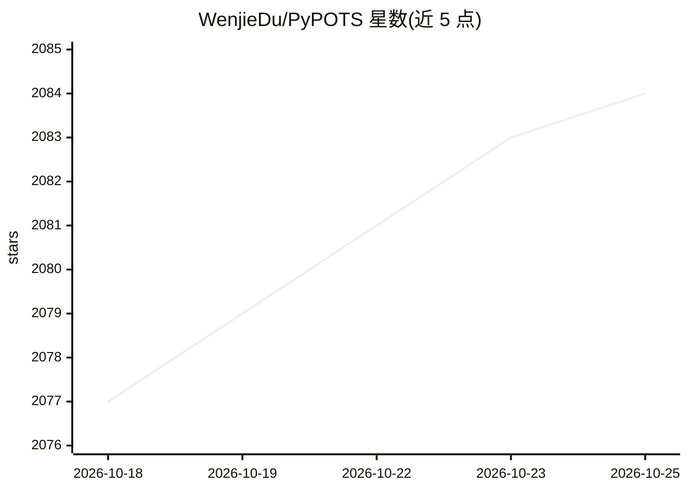

# WenjieDu/PyPOTS

⭐ 2,084 · Python · BSD-3-Clause · 推送 2026-10-19 · [GitHub](https://github.com/WenjieDu/PyPOTS) · [官网](https://pypots.com) · 个人维护 · 中文 README

**含缺失值时间序列的机器学习工具箱：插补/分类/聚类/预测/异常检测**

面向含缺失值多元时间序列（POTS）的 Python 工具箱，覆盖插补、分类、聚类、预测、异常检测五类任务，收录 50 余个经典与神经网络算法（SAITS、BRITS、TimesNet、Transformer 等），提供统一 API。对非 POTS 原生的模型（如 Informer、PatchTST）采用 SAITS 论文的嵌入策略与 ORT+MIT 训练方式使其可处理缺失数据。配套 TSDB（172 个公开数据集加载）、PyGrinder（缺失模拟）、BenchPOTS（基准评测）与 BrewPOTS（教程）组成生态，v2 起用 Optuna 做超参优化。经 PyPI 与 Anaconda 发行，BSD-3 许可。

## 筛选速览

| 维度 | 判定 | 备注 |
|---|---|---|
| AI 角色 | `ai-native` | 本体是模型或模型工具 |
| 许可风险 | `permissive` | BSD-3-Clause |
| 部署形态 | `library` | 以包/库形式分发 |
| 模型依赖 | — | README 未给出锁定关系 |
| 硬件要求 | — | 无带数字的原话,不猜 |
| 安装摩擦 | `low` | 无编译、无系统依赖或容器化 |
| 成熟度 | — | 结构信号不足 |

## 能力要点

- 5 类任务 × 50 余个算法的统一 API
- 非 POTS 模型经 ORT+MIT 策略适配缺失值输入
- 配套 TSDB/PyGrinder/BenchPOTS/BrewPOTS 生态
- TS2Vec 时间序列表示学习与向量化

## 适用场景

- 工业传感器数据有缺失时做插补或预测
- 医疗等不完整时间序列的分类与聚类分析
- 复现和对比 POTS 算法、做学术基准实验

## 场景标签

 · 领域:时间序列机器学习/数据挖掘

## 证据(README 行号)

> L9:  a Python toolbox for machine learning on Partially-Observed Time Series
> L90: PyPOTS supports imputation, classification, clustering, forecasting, and anomaly detection tasks on multivariate

## 星数曲线

2026-10-18 2,077 → 2026-10-25 2,084（+7）

---
*卡片 v1 · prompt 1.4 · 生成 2026-10-21 · 置信度 high · 依据 README sha `a37f376d543f` · [字段定义](../../DATASET.md)*
