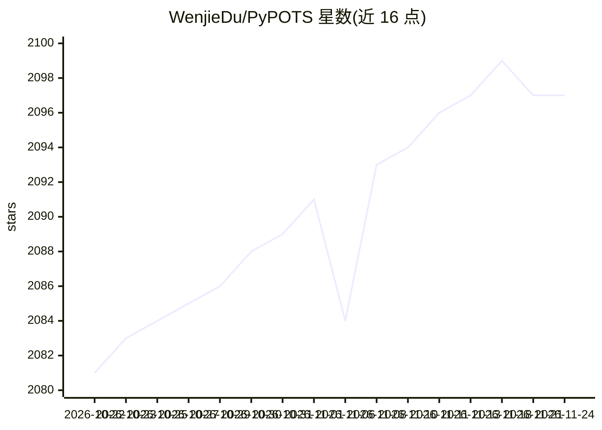

# WenjieDu/PyPOTS

⭐ 2,097 · Python · BSD-3-Clause · 推送 2026-11-18 · [GitHub](https://github.com/WenjieDu/PyPOTS) · [官网](https://pypots.com) · 个人维护

**面向不完整时间序列的 Python 机器学习工具箱**

针对含缺失值的部分观测时间序列（POTS）提供统一 Python 工具箱，覆盖插补、分类、聚类、预测、异常检测及表示学习任务，收录 50 余种算法（含 SAITS、GRU-D、CSDI、Time-LLM 等），并以表格标注各算法支持的任务类型；v2 起基于 Optuna 提供超参数优化支持。通过 pip/conda 安装，配套 TSDB 数据加载、PyGrinder 缺失模拟、BenchPOTS 基准与 BrewPOTS 教程生态。面向处理工业等场景不完整时序数据的工程师与研究者。

## 筛选速览

| 维度 | 判定 | 备注 |
|---|---|---|
| AI 角色 | `ai-native` | 本体是模型或模型工具 |
| 许可风险 | `permissive` | BSD-3-Clause |
| 部署形态 | `library` | 以包/库形式分发 |
| 模型依赖 | — | README 未给出锁定关系 |
| 硬件要求 | — | 无带数字的原话,不猜 |
| 安装摩擦 | `low` | 无编译、无系统依赖或容器化 |
| 成熟度 | — | 结构信号不足 |

## 能力要点

- 50+ 算法覆盖插补/分类/聚类/预测/异常检测 5 类任务及表示学习
- 统一 API、文档与交互式教程，支持 Optuna 超参数优化
- 生态包含 TSDB（172 个数据集加载）、PyGrinder、BenchPOTS、BrewPOTS
- 对不适配缺失输入的模型统一应用 SAITS 的 ORT+MIT 嵌入与训练策略

## 适用场景

- 对含传感器缺失的工业时序数据做插补与清洗
- 在不完整医疗时序数据上做分类与异常检测
- 对多变量时序做预测并对比不同算法性能
- 加载公开时序数据集并模拟 MCAR/MAR/MNAR 缺失

## 场景标签

 · 领域:数据科学/时间序列分析

## 证据(README 行号)

> L9:  a Python toolbox for machine learning on Partially-Observed Time Series
> L90: PyPOTS supports imputation, classification, clustering, forecasting, and anomaly detection tasks on multivariate

## 星数曲线

2026-10-22 2,081 → 2026-11-24 2,097（+16）

---
*卡片 v1 · prompt 1.4 · 生成 2026-11-23 · 置信度 high · 依据 README sha `057289afaa5a` · [字段定义](../../DATASET.md)*
