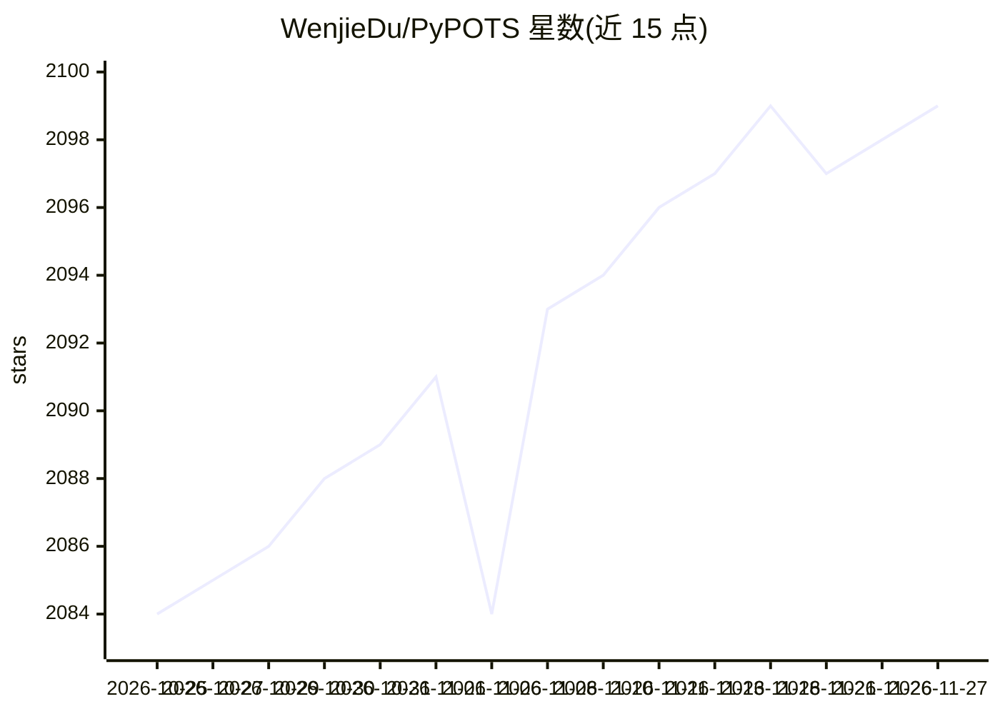

# WenjieDu/PyPOTS

⭐ 2,099 · Python · BSD-3-Clause · 推送 2026-11-26 · [GitHub](https://github.com/WenjieDu/PyPOTS) · [官网](https://pypots.com) · 个人维护

**面向科研的缺失值时间序列分析 Python 工具箱**

PyPOTS 是针对部分观测时间序列（POTS）的 Python 工具箱，提供 50+ 模型的统一 API，覆盖插补、预测、分类、聚类、异常检测与表示学习六类任务。模型含经典方法、深度网络、LLM-based 模型与时间序列基础模型；原生支持缺失值输入，内置缺失机制模拟、Optuna 调参与 HDF5 惰性加载。需 Python 3.10+，经 PyPI、Conda、Docker 或源码安装，BSD-3 许可，附 arXiv 论文与 KDD 教程。

## 筛选速览

| 维度 | 判定 | 备注 |
|---|---|---|
| AI 角色 | `ai-native` | 本体是模型或模型工具 |
| 许可风险 | `permissive` | BSD-3-Clause |
| 部署形态 | `self-host` | docker 或自建部署 |
| 模型依赖 | — | README 未给出锁定关系 |
| 硬件要求 | — | 无带数字的原话,不猜 |
| 安装摩擦 | `low` | 无编译、无系统依赖或容器化 |
| 成熟度 | — | 结构信号不足 |

## 能力要点

- 50+ 模型统一 API，覆盖六类时间序列分析任务
- 原生支持缺失值，无需预先插补
- 支持 CPU、NVIDIA CUDA GPU 与 Ascend NPU 加速及 DDP 多卡训练
- 提供 Optuna 超参优化与 HDF5 惰性加载

## 适用场景

- 对含缺失值的工业/医疗传感器数据进行插补与清洗
- 对不规则采样时间序列做分类或聚类研究
- 复现时间序列模型论文基准实验
- 模拟 MCAR/MAR/BNAR 缺失机制做评估

## 场景标签

`数据分析` `科研工具` · 领域:效率与自动化

## 证据(README 行号)

> L62: PyPOTS (pronounced "Pie Pots") is an open-source Python toolbox for time series analysis, offering
> L63: **50+ models and methods with unified APIs** for imputation, forecasting, classification, clustering, anomaly detec
> L86: - **Rich model zoo:** 50+ models and methods spanning classical approaches, deep learning, LLM-based models, and ti

## 星数曲线

2026-10-25 2,084 → 2026-11-27 2,099（+15）

---
*卡片 v1 · prompt 1.4 · 生成 2026-11-26 · 置信度 high · 依据 README sha `b07dee087fb2` · [字段定义](../../DATASET.md)*
