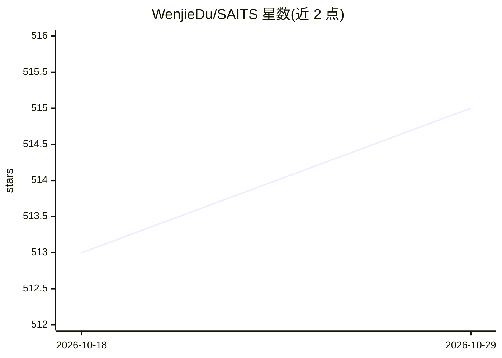

# WenjieDu/SAITS

⭐ 515 · Python · MIT · 推送 2026-08-25 · [GitHub](https://github.com/WenjieDu/SAITS) · [官网](https://doi.org/10.1016/j.eswa.2023.119619) · 个人维护

**论文 SAITS 官方 PyTorch 实现：自注意力时间序列缺失值插补**

SAITS 论文（发表于 Expert Systems with Applications）的官方代码仓库，提供基于纯自注意力机制（无递归设计）的多变量不完整时间序列插补模型的训练与测试实现，由 PyTorch 驱动、MIT 许可开源。仓库含模型实现目录、配置文件、数据集下载与预处理脚本及 NNI 超参搜索配置；README 给出生成数据后训练测试的流程，并说明依赖通过 conda 环境文件安装。SAITS 亦被集成进同作者的 PyPOTS 工具箱，且其嵌入与训练策略已适配 20 余个预测模型用于插补任务。

## 筛选速览

| 维度 | 判定 | 备注 |
|---|---|---|
| AI 角色 | `ai-native` | 本体是模型或模型工具 |
| 许可风险 | `permissive` | MIT |
| 部署形态 | `None` |  |
| 模型依赖 | — | README 未给出锁定关系 |
| 硬件要求 | — | 无带数字的原话,不猜 |
| 安装摩擦 | `low` | 无编译、无系统依赖或容器化 |
| 成熟度 | — | 结构信号不足 |

## 能力要点

- 纯自注意力机制（无递归设计）做通用时间序列插补
- 提供模型实现、配置、数据集生成脚本与 NNI 超参搜索配置
- SAITS 已被集成进 PyPOTS 工具箱，策略适配 20 余个预测模型
- 依赖环境通过 conda_env_dependencies.yml 一键创建

## 适用场景

- 对含 NaN 缺失的多变量时间序列做插补
- 复现论文实验或基于 SAITS 框架改造自己的研究模型
- 部分观测时间序列（POTS）数据挖掘的科研场景

## 场景标签

`科研工具` · 领域:学习与行业

## 证据(README 行号)

> L35: The official code repository is for the paper SAITS: Self-Attention-based Imputation for Time Series
> L43: SAITS is the first work applying pure self-attention without any recursive design in the algorithm for general time

## 星数曲线

2026-10-18 513 → 2026-10-29 515（+2）

---
*卡片 v1 · prompt 1.4 · 生成 2026-10-21 · 置信度 high · 依据 README sha `335972504397` · [字段定义](../../DATASET.md)*
