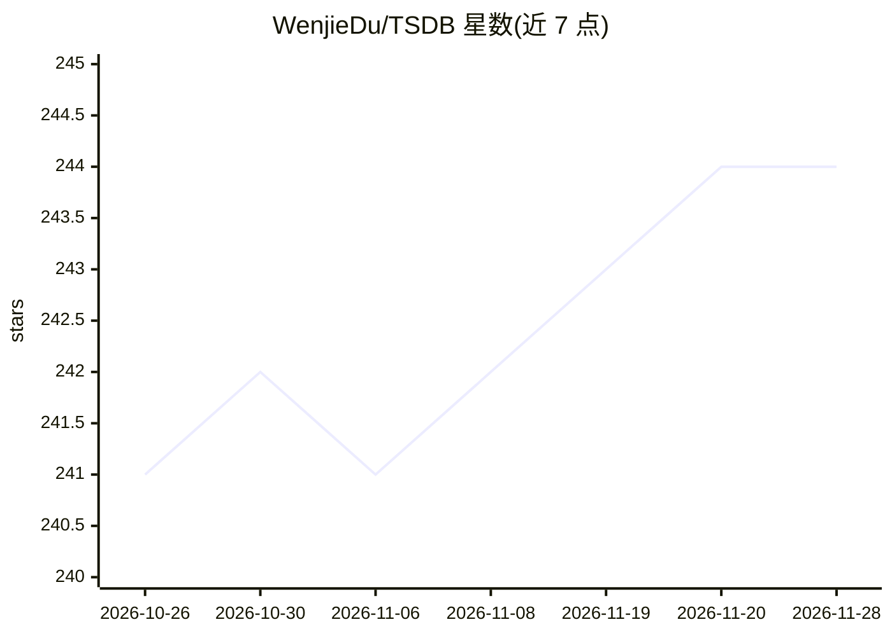

# WenjieDu/TSDB

⭐ 244 · Python · BSD-3-Clause · 推送 2026-11-27 · [GitHub](https://github.com/WenjieDu/TSDB) · [官网](https://pypots.com/ecosystem/#TSDB) · 个人维护

**为 ML 研究者提供一行代码加载 173 个公开时间序列数据集**

TSDB（Time Series Data Beans）是开源 Python 工具箱，通过统一 API 提供 173 个公开时间序列数据集，覆盖医疗、能源、天气、交通等领域，包含 UCR/UEA 分类数据集与 TSQA。它作为 PyPOTS 生态的数据获取层，负责数据集发现、下载、解压、加载与本地缓存，加载器做数据集特定的基础准备而非任务级归一化或缺失值插补，也支持原始文件下载。要求 Python 3.10+，支持显式刷新与缓存迁移。

## 筛选速览

| 维度 | 判定 | 备注 |
|---|---|---|
| AI 角色 | `ai-knowledge` | 知识聚合/清单类 |
| 许可风险 | `permissive` | BSD-3-Clause |
| 部署形态 | `library` | 以包/库形式分发 |
| 模型依赖 | — | README 未给出锁定关系 |
| 硬件要求 | — | 无带数字的原话,不猜 |
| 安装摩擦 | `low` | 无编译、无系统依赖或容器化 |
| 成熟度 | — | 结构信号不足 |

## 能力要点

- 统一 API 加载 173 个公开时间序列数据集
- 无需下载数据即可查看源 URL、版本与加载器信息的元数据发现
- 本地缓存复用，支持刷新与跨盘迁移
- 分阶段下载与安全解压，可从不完整操作中恢复

## 适用场景

- 为时间序列预测/插补/分类实验快速获取公开数据集
- 研究复现时保留数据集来源与引用信息
- 按领域（医疗/能源/交通/天气）浏览可用数据集

## 场景标签

`科研工具` · 领域:学习与行业

## 证据(README 行号)

> L54: TSDB (Time Series Data Beans) is an open-source Python toolbox that makes **173 public time series datasets availab
> L64: - **Rich dataset collection:** 173 datasets from healthcare, energy, weather, traffic, and other domains, including
> L73: TSDB v1.0 requires Python 3.10 or later and is available on PyPI and Anaconda. See the installation guide for optio

## 星数曲线

2026-10-26 241 → 2026-11-28 244（+3）

---
*卡片 v1 · prompt 1.4 · 生成 2026-11-27 · 置信度 high · 依据 README sha `c4ef27bf16e6` · [字段定义](../../DATASET.md)*
