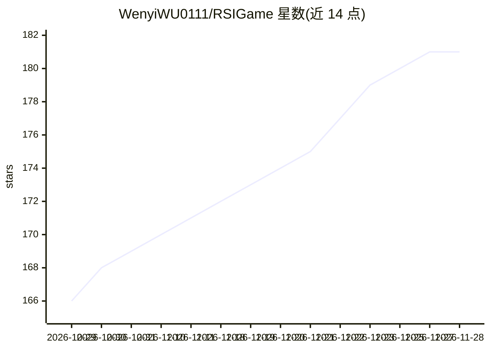

# WenyiWU0111/RSIGame

⭐ 181 · Python · Apache-2.0 · 推送 2026-10-30 · [GitHub](https://github.com/WenyiWU0111/RSIGame) · [官网](https://huggingface.co/spaces/RSIGame/rsigame-page) · 组织维护 · 中文 README

**用智能体循环自主开发并迭代改进生成式游戏的框架**

RSIGame 是一个自主智能体游戏开发框架：内层每轮执行探索-诊断-修改-验证，由智能体实际运行游戏并记录证据，修复智能体据单一目标改代码，独立智能体回放验证；外层由全局质量监控保存最佳检查点并检测饱和或回归。支持 Godot 与 Phaser 两种引擎，依赖 GameCraft-Bench 提供任务与评分。要求 Linux/macOS，需配置模型 API key、Node 20+ 修复智能体及 Godot 等运行环境；数据与评分产物发布在 Hugging Face 数据集。

## 筛选速览

| 维度 | 判定 | 备注 |
|---|---|---|
| AI 角色 | `ai-native` | 本体是模型或模型工具 |
| 许可风险 | `permissive` | Apache-2.0 |
| 部署形态 | `library` | 以包/库形式分发 |
| 模型依赖 | — | README 未给出锁定关系 |
| 硬件要求 | — | 无带数字的原话,不猜 |
| 安装摩擦 | `medium` | 含编译或系统依赖之一 |
| 成熟度 | — | 结构信号不足 |

## 能力要点

- 探索-诊断-修改-验证的本地循环与全局质量监控/饱和检测的外层循环
- 支持 Godot 与 Phaser 两种游戏引擎的统一评分（GameCraft-Bench rubric）
- 通过回环代理记录全部模型调用的 token 与成本账目
- 提供经验内化训练的数据管线与训练代码（data_pipeline/、training/）

## 适用场景

- 对已生成的游戏基础版本做长期自动迭代改进
- 在 GameCraft-Bench 任务上复现论文中的基准实验
- 按预算控制开发轮数并自动在饱和时停止

## 场景标签

`编码 Agent` `模型评测` · 领域:编码与开发

## 证据(README 行号)

> L38: >We introduce **RSIGame**, an autonomous agentic game development framework with recursive self-improvement. **RSIG
> L63: **The inner loop**, once per round:
> L92: **GameCraft-Bench** supplies the tasks, rubrics and replay harness. It is a

## 星数曲线

2026-10-29 166 → 2026-11-28 181（+15）

---
*卡片 v1 · prompt 1.4 · 生成 2026-11-26 · 置信度 high · 依据 README sha `0e373fb7d5d7` · [字段定义](../../DATASET.md)*
