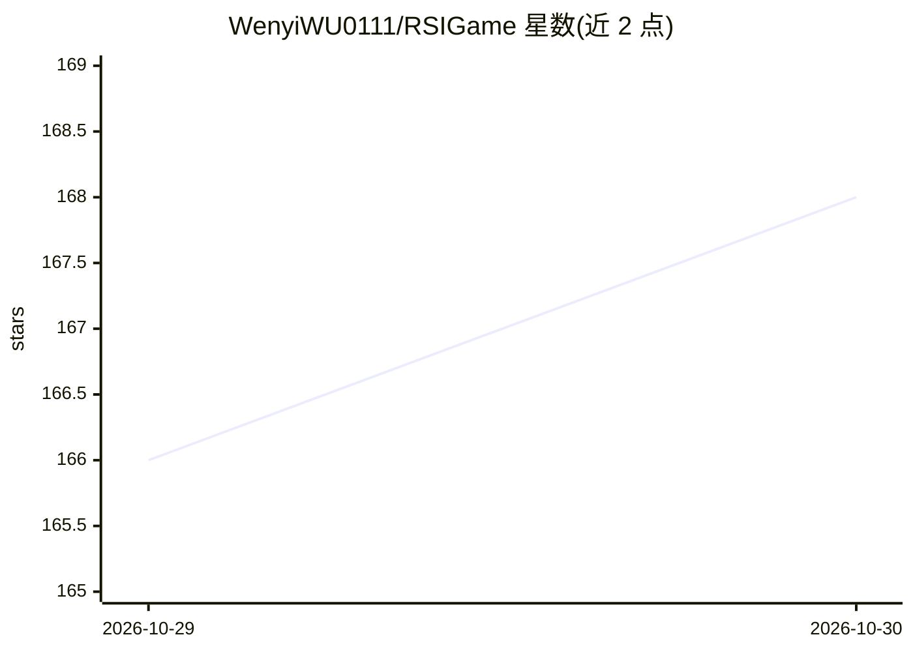

# WenyiWU0111/RSIGame

⭐ 168 · Python · Apache-2.0 · 推送 2026-10-11 · [GitHub](https://github.com/WenyiWU0111/RSIGame) · [官网](https://huggingface.co/spaces/RSIGame/rsigame-page) · 组织维护 · 中文 README

**自主 agentic 游戏开发框架：递归自改进生成游戏**

研究型框架，通过局部 explore-diagnose-improve 循环与全局质量监控循环，对 LLM 生成的可执行游戏（Godot/Phaser）进行自主探索、诊断、修改与验证，持续迭代至饱和并保留最优 checkpoint。含将开发经验内化到生成器的训练流程，在 140 个 GameCraft-Bench 任务上评测。需 Linux/macOS、Node 20+、Godot 4.6.2 及配套 GameCraft-Bench 与 OpenGame fork；模型经 loopback 代理计量 token 成本。

## 筛选速览

| 维度 | 判定 | 备注 |
|---|---|---|
| AI 角色 | `ai-ecosystem` | LLM/agent 周边工具 |
| 许可风险 | `permissive` | Apache-2.0 |
| 部署形态 | `library` | 以包/库形式分发 |
| 模型依赖 | — | README 未给出锁定关系 |
| 硬件要求 | — | 无带数字的原话,不猜 |
| 安装摩擦 | `medium` | 含编译或系统依赖之一 |
| 成熟度 | — | 结构信号不足 |

## 能力要点

- 局部 explore-diagnose-improve 循环 + 全局质量监控与饱和检测
- 通过训练将开发经验内化到生成器，降低生成 token 消耗
- 覆盖 Godot 与 Phaser 两引擎、140 个 GameCraft-Bench 任务
- loopback 代理记录全部模型调用的 token 与成本

## 适用场景

- 研究自动游戏生成与迭代改进方法
- 对生成游戏进行自动测试与质量评分
- 复现论文实验或基于 run 产物做分析

## 场景标签

`编码 Agent` · 领域:编码与开发

## 证据(README 行号)

> L38: >We introduce **RSIGame**, an autonomous agentic game development framework with recursive self-improvement. **RSIG
> L40: >Beyond test-time improvement, **RSIGame** further internalizes successful development experience into the generato
> L84: Requires **Linux** (or macOS): the loop runs its agents in process groups and

## 星数曲线

2026-10-29 166 → 2026-10-30 168（+2）

---
*卡片 v1 · prompt 1.4 · 生成 2026-10-28 · 置信度 mid · 依据 README sha `741a94f2cae5` · [字段定义](../../DATASET.md)*
