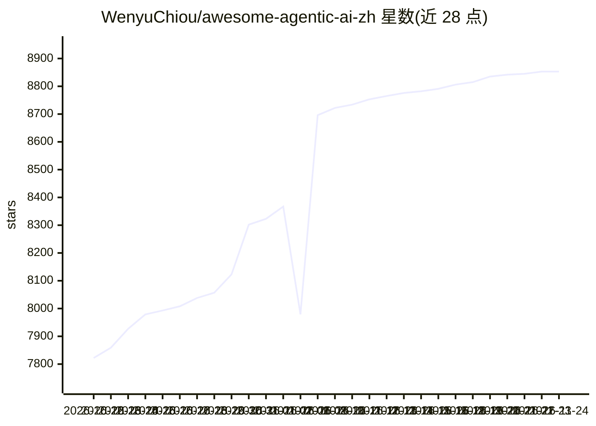

# WenyuChiou/awesome-agentic-ai-zh

⭐ 8,853 · Python · MIT · 推送 2026-11-21 · [GitHub](https://github.com/WenyuChiou/awesome-agentic-ai-zh) · [官网](https://wenyuchiou.github.io/awesome-agentic-ai-zh/) · 个人维护 · 中文 README

**面向中文学习者的 AI Agent 三语学习路线图与资源清单**

三语（繁中/简中/英文）维护的 agentic AI 学习路线图：从 LLM 基础到多智能体系统，共 10 个学习站（Stage 0–8 及 7.5），分 Track A（使用 Claude Code 等 CLI Agent 完成工作）与 Track B（从零构建 Agent），并按研究人员、开发者、教师、知识工作者、日常使用者五类角色提供选读路线。收录 240+ 精选资源，提供可直接执行的小练习、核心名词表与进度记录，完整清单在 RESOURCES.md。MIT 授权，由个人维护。

## 筛选速览

| 维度 | 判定 | 备注 |
|---|---|---|
| AI 角色 | `ai-knowledge` | 知识聚合/清单类 |
| 许可风险 | `permissive` | MIT |
| 部署形态 | `None` |  |
| 模型依赖 | — | README 未给出锁定关系 |
| 硬件要求 | — | 无带数字的原话,不猜 |
| 安装摩擦 | `low` | 无编译、无系统依赖或容器化 |
| 成熟度 | — | 结构信号不足 |

## 能力要点

- Stage 0–8 共 10 个学习站，Track A/B 双路线组织
- 按研究人员/开发者/教师/知识工作者/日常使用者五类角色选读
- 240+ 精选资源，含可执行练习与核心名词表
- 繁中/简中/英文三语内容

## 适用场景

- 想系统学习从 LLM 基础到构建 Agent 的完整路径
- 想学会用 Claude Code 等 CLI Agent 完成日常工作
- 为教学或共学寻找结构化的中文 AI Agent 教材

## 场景标签

`教程课程` `精选清单` · 领域:学习与行业

## 证据(README 行号)

> L7: **🤖 一張從「AI Agent 是什麼」走到「能做出可靠系統」的學習地圖**
> L30: 這裡的角色是**學習路線圖 + 精選資源 + 可直接執行的小練習**。需要完整章節時，我們會帶你去官方文件、Datawhale Hello-Agents 或對應的 Cookbook，不重寫另一套百科全書。需要連模型時，每個練習會再
> L61: 這張地圖共有 **8 個主題 Stage + Stage 0 準備關 + Stage 7.5 進階閱讀站**，也就是 **10 個學習站**。Track A／B 讀者先確認 **Stage 0–2 共用基礎**；已經會 Pytho

## 星数曲线

2026-10-22 7,822 → 2026-11-24 8,853（+1,031）

---
*卡片 v1 · prompt 1.4 · 生成 2026-11-22 · 置信度 high · 依据 README sha `039d4e107c1f` · [字段定义](../../DATASET.md)*
