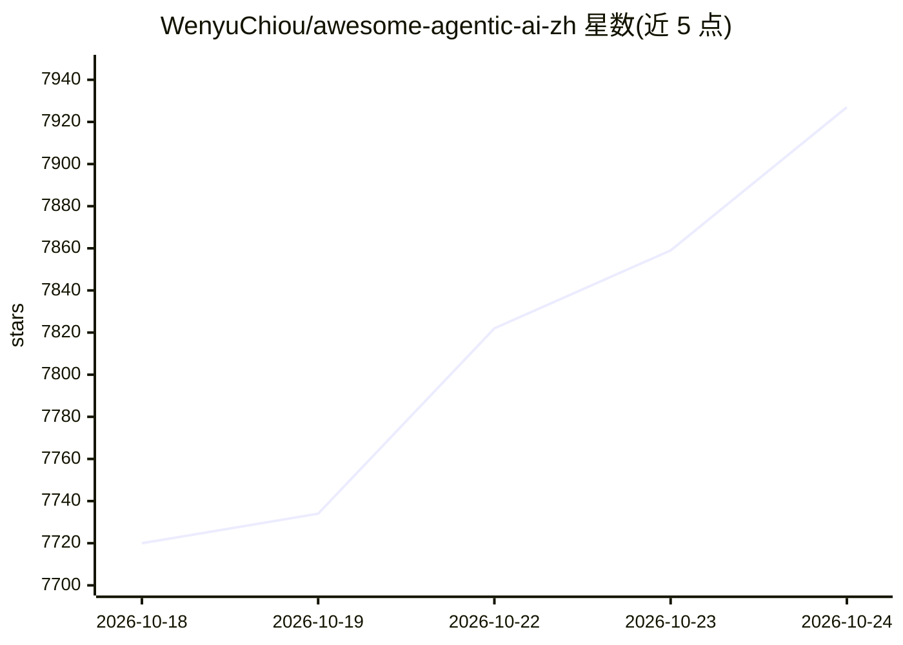

# WenyuChiou/awesome-agentic-ai-zh

⭐ 7,927 · Python · MIT · 推送 2026-10-23 · [GitHub](https://github.com/WenyuChiou/awesome-agentic-ai-zh) · [官网](https://wenyuchiou.github.io/awesome-agentic-ai-zh/) · 个人维护 · 中文 README

**三语 AI Agent 学习路线图：从 LLM 基础到多 Agent 系统**

繁中/简中/英文三语的学习地图仓库：从 Stage 0 准备关到 Stage 8 共 10 个学习站，先经 Stage 0–2 共用基础再分流到 Track A（使用 Claude Code、OpenCode 等 CLI Agent 完成工作）与 Track B（从零打造 Agent，涵盖 Agent Loop、Workflow Graph、RAG/Memory、上线工程）。内容以精选资源、名词表、可执行 starter.py 练习与 RESOURCES.md 资源清单组织，不重写百科全书；另按研究、开发、教学、知识工作、日常使用五种角色给出选读路线。提供线上文件站与 git clone 下载方式。

## 筛选速览

| 维度 | 判定 | 备注 |
|---|---|---|
| AI 角色 | `ai-knowledge` | 知识聚合/清单类 |
| 许可风险 | `permissive` | MIT |
| 部署形态 | `None` |  |
| 模型依赖 | — | README 未给出锁定关系 |
| 硬件要求 | — | 无带数字的原话,不猜 |
| 安装摩擦 | `low` | 无编译、无系统依赖或容器化 |
| 成熟度 | — | 结构信号不足 |

## 能力要点

- 8 个主题 Stage + Stage 0 准备关 + Stage 7.5 进阶阅读站，共 10 个学习站
- Track A（CLI Power User）与 Track B（Agent Builder）双路线分流
- 按研究人员/开发者/教师/知识工作者/日常使用者五种身份给出选读路线
- 每个 starter.py 为可执行参考，配套名词表与完整资源清单 RESOURCES.md

## 适用场景

- 系统学习从 LLM 基础到多 Agent 系统的知识体系
- 选一个 CLI Agent 并建立可重复的工作流程
- 从零实现 Agent Loop、Workflow Graph 与最小 RAG 流程
- 记录学习进度并按自身角色选读对应路线

## 场景标签

`教程课程` · 领域:学习与行业

## 证据(README 行号)

> L28: 這裡的角色是**學習路線圖 + 精選資源 + 可直接執行的小練習**。需要完整章節時，我們會帶你去官方文件、Datawhale Hello-Agents 或對應的 Cookbook，不重寫另一套百科全書。需要連模型時，每個練習會再
> L57: AI Agent 學習地圖

## 星数曲线

2026-10-18 7,720 → 2026-10-24 7,927（+207）

---
*卡片 v1 · prompt 1.4 · 生成 2026-10-20 · 置信度 high · 依据 README sha `b54028504052` · [字段定义](../../DATASET.md)*
