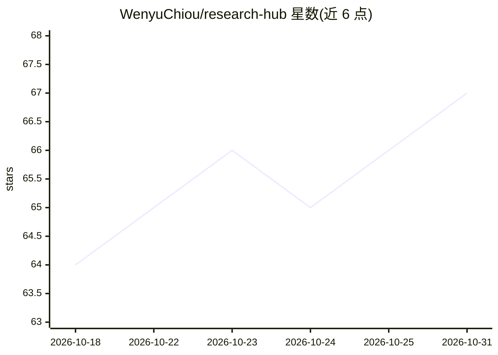

# WenyuChiou/research-hub

⭐ 67 · Python · MIT · 推送 2026-10-30 · [GitHub](https://github.com/WenyuChiou/research-hub) · [官网](https://pypi.org/project/research-hub-pipeline/) · 个人维护 · 中文 README

**面向研究者的本地科研工作区，供人与 AI 助手协作管理文献到手稿**

连接 Zotero、Obsidian、NotebookLM 的本地研究工作区，以六页工作区 UI 组织项目问题、文献筛选、证据-来源关联、方法与结果、手稿登记与评审交付。通过 CLI、MCP、REST 接入 AI 助手：支持便携式任务交接（导出任务给 AI host、导入其文稿与哈希）或经认证的 Codex CLI 连接写作，产出均需人工评审后接受。任务保留输入版本与决策记录，注册字节变更可标记任务过期。工作区预览版未合入主线且未发布，PyPI 1.2.0 不含；现有文献仪表盘可经 pip 安装体验。NotebookLM 集成上次认证尝试失败，处于降级/未核验状态。

## 筛选速览

| 维度 | 判定 | 备注 |
|---|---|---|
| AI 角色 | `ai-ecosystem` | LLM/agent 周边工具 |
| 许可风险 | `permissive` | MIT |
| 部署形态 | `library` | 以包/库形式分发 |
| 模型依赖 | — | README 未给出锁定关系 |
| 硬件要求 | — | 无带数字的原话,不猜 |
| 安装摩擦 | `low` | 无编译、无系统依赖或容器化 |
| 成熟度 | — | 结构信号不足 |

## 能力要点

- 文献-证据-手稿的可追溯六页工作区，任务保留输入版本与决策记录
- 便携 AI 交接与经认证的 Codex 连接写作两种模式，产出需人工评审
- 通过 CLI/MCP/REST/dashboard 接入，可选 Zotero、Semantic Scholar、Tavily/Brave 搜索后端
- 主工作区为未合入 PR 的预览快照，PyPI 现行版本仅含文献仪表盘

## 适用场景

- 组织文献综述的纳入/排除决策并连接证据声明与来源
- 把手稿写作任务交给 AI 助手并保留人工评审与接受记录
- 跨 Zotero/Obsidian/NotebookLM 统一管理本地研究材料

## 场景标签

`科研工具` `知识库管理` · 领域:知识与检索

## 证据(README 行号)

> L68: |Portable handoff|Export a task for your AI host; import its prose and candidate hashes. Export leaves the task wai
> L69: |Connected Codex|An authenticated, compatible Codex CLI uses an explicitly trusted public writing bundle to produce
> L103: Connect through MCP/REST, check the AI host support matrix, or use local file import. The CLI reference, EZproxy g

## 星数曲线

2026-10-18 64 → 2026-10-31 67（+3）

---
*卡片 v1 · prompt 1.4 · 生成 2026-10-18 · 置信度 mid · 依据 README sha `84355acc1462` · [字段定义](../../DATASET.md)*
