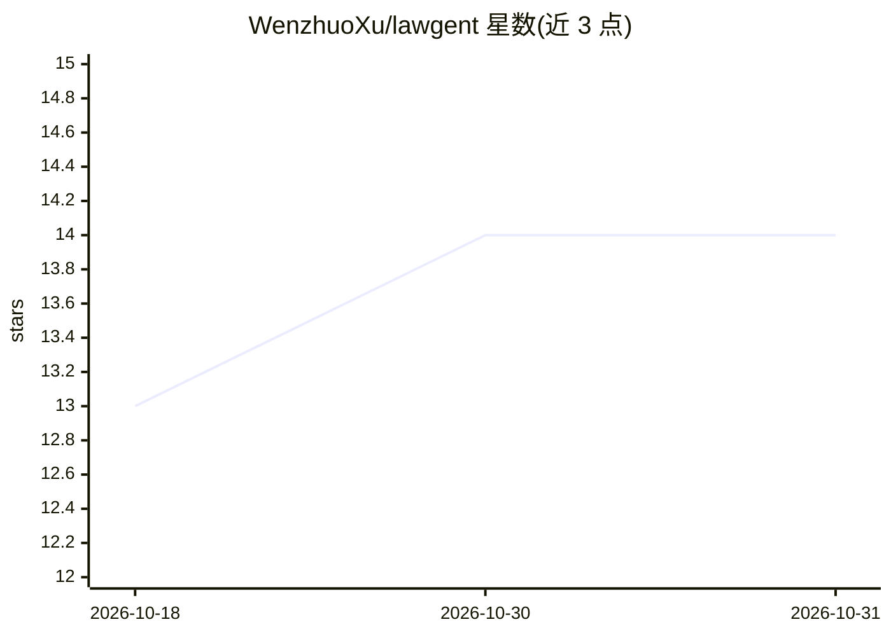

# WenzhuoXu/lawgent

⭐ 14 · Python · MIT · 推送 2026-10-15 · [GitHub](https://github.com/WenzhuoXu/lawgent) · 个人维护 · 中文 README

**面向执业律师的多法域法律 AI agent，引文逐条核验**

Lawgent 是围绕模型构建的法律工作流 harness：从官方数据库（国家法律法规数据库、PKULaw、eCFR、EUR-Lex 等）实时拉取一手法律文本，回答中每条引文附条款定位，输出前经 citation audit 重新抓取原文回验，未通过的会被修复或标记。支持 CN/US/EU/ET/ICAO 等法域为运行时过滤轴，可将复杂事项拆分给最多三个并行子 agent。提供 15 项执业技能（合同审查、NDA 分诊、诉讼分析等）、项目记忆、按模型的成本账本，及 CLI/Web UI/HTTP API 三种入口。声明不构成法律意见，所有输出须由执业律师复核。

## 筛选速览

| 维度 | 判定 | 备注 |
|---|---|---|
| AI 角色 | `ai-native` | 本体是模型或模型工具 |
| 许可风险 | `permissive` | MIT |
| 部署形态 | `library` | 以包/库形式分发 |
| 模型依赖 | locked-api |  |
| 硬件要求 | — | 无带数字的原话,不猜 |
| 安装摩擦 | `low` | 无编译、无系统依赖或容器化 |
| 成熟度 | — | 结构信号不足 |

## 能力要点

- 每条引文附 pinpoint 状态并在输出前经原文回验审计
- CN/US/EU/ET/ICAO 多法域连接器按辖区运行时过滤
- 复杂事项可拆分给最多三个并行专家子 agent（run_workflow）
- 15 项执业技能：合同逐条审查、NDA 分诊、双语起草、Word 修订线等

## 适用场景

- 多国执业律师做跨法域法律研究与比较法备忘录
- 合同逐条审查并输出带真实 Word 修订线的红线稿
- 诉讼案情分析与争点归纳、合规义务核查
- 要求每个引用可回溯到一手法源的法律检索

## 场景标签

`多智能体` `科研工具` · 领域:Agent 开发

## 证据(README 行号)

> L3: **An open-source legal AI agent — grounded, multi-jurisdiction, citation-verified.**
> L42: **2. Every claim carries a pinpoint, and pinpoints are audited, not trusted.** An answer that
> L145: |`ANTHROPIC_API_KEY` · `OPENAI_API_KEY`|Claude or GPT provider, with its hosted web search and fetch|at least one|

## 星数曲线

2026-10-18 13 → 2026-10-31 14（+1）

---
*卡片 v1 · prompt 1.4 · 生成 2026-10-31 · 置信度 mid · 依据 README sha `aad902fe74f3` · [字段定义](../../DATASET.md)*
