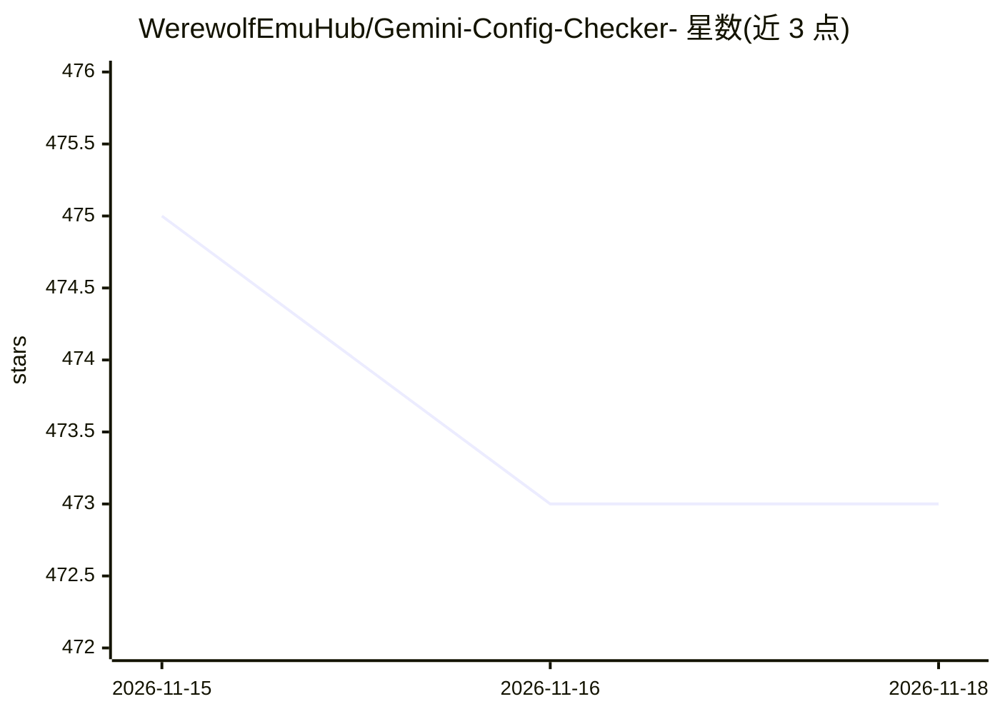

# WerewolfEmuHub/Gemini-Config-Checker-

⭐ 473 · Go · Apache-2.0 · 推送 2026-11-15 · [GitHub](https://github.com/WerewolfEmuHub/Gemini-Config-Checker-) · 组织维护

**测试代理配置能否进入 Google AI Studio/Gemini 的桌面扫描器**

面向需要经代理访问 Google AI Studio 与 Gemini 的用户的配置扫描工具：在登录 Google 账号的浏览器中逐条测试 vless/vmess/trojan/ss 等代理配置，读取 Google 的区域判定；Simple 模式测自有配置，Advanced 模式将免费配置链在一个可用基础配置之后寻找可被接受的网络出口。内嵌 Xray-core 引擎，提供可编辑的 anti-DPI 参数档（Finalmask/指纹/ALPN/密码套件）。以 Wails 桌面应用形式发布 Windows/macOS/Linux/Android 构建，另有 Web 服务器模式；区域检查需 Chrome/Edge/Brave，Android 仅支持连通性检查。作者声明为早期预发布版，仅 Windows 经过端到端验证。

## 筛选速览

| 维度 | 判定 | 备注 |
|---|---|---|
| AI 角色 | `ai-ecosystem` | LLM/agent 周边工具 |
| 许可风险 | `permissive` | Apache-2.0 |
| 部署形态 | `desktop` | 安装包/桌面程序 |
| 模型依赖 | — | README 未给出锁定关系 |
| 硬件要求 | — | 无带数字的原话,不猜 |
| 安装摩擦 | `medium` | 含编译或系统依赖之一 |
| 成熟度 | `idea` | |

## 能力要点

- 以登录账号的浏览器实测 Google 的区域可用性判定（每配置约 20–40 秒）
- Simple/Advanced 双模式，Advanced 支持基础配置+免费配置的链式出口
- 可编辑的 anti-DPI 参数档（Finalmask TLS 分片、ALPN、密码套件）
- 导出链接、base64 或完整/链式 Xray 配置

## 适用场景

- 在批量代理配置中筛出能打开 AI Studio 和 Gemini 的条目
- 基础配置可连但被 Google 区域封锁时，链式寻找其他出口
- 在网络过滤环境下配合 anti-DPI 参数测试 Cloudflare 配置连通性

## 场景标签

`网络安全` · 领域:学习与行业

## 证据(README 行号)

> L11: Find proxy configs that actually get you into **Google AI Studio and Gemini**, by testing each one the way a person
> L50: Google decides region availability **per signed-in account, after the page has loaded**. A plain HTTP request (even

## 星数曲线

2026-11-15 475 → 2026-11-18 473（-2）

---
*卡片 v1 · prompt 1.4 · 生成 2026-11-17 · 置信度 mid · 依据 README sha `846e83cebb20` · [字段定义](../../DATASET.md)*
