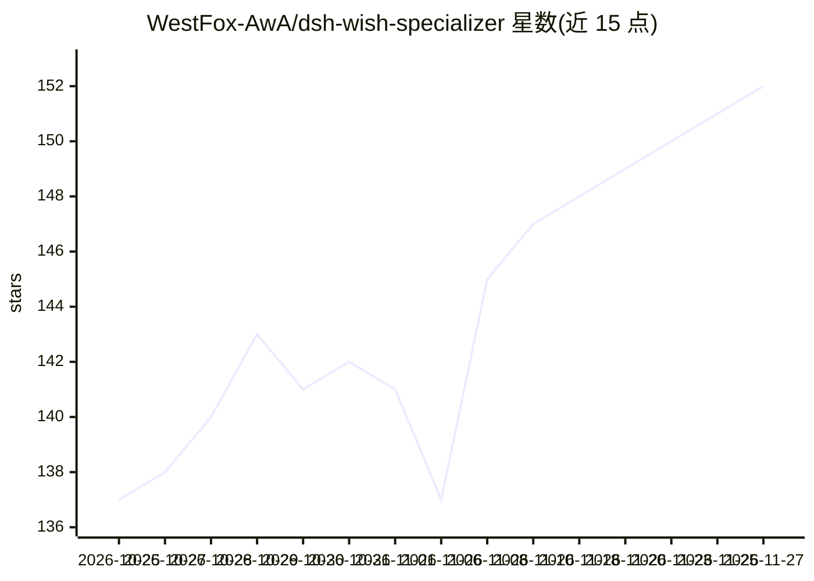

# WestFox-AwA/dsh-wish-specializer

⭐ 152 · JavaScript · BSD-3-Clause · 推送 2026-11-23 · [GitHub](https://github.com/WestFox-AwA/dsh-wish-specializer) · 个人维护 · 中文 README

**DSH 插件：在发送前把一句话愿望补全为可执行要求**

面向 DSH（DeepSeek Harness）宿主的 Web 插件，在用户按下发送之前拦截输入，将一句话愿望补充为包含审美基调、光影材质、构图层次、交互状态与验收口径的方向性指导，随原话一起交给工作 AI；不改写原文、不做架构分叉决策。提供关闭/轻度/标准/重度四档、3000 token 解释包预算、独立只读模型复核的顾问面板，以及「本次注入」卡片查看注入内容。仅通过仓库 Release 附件（.tgz）分发，不上发 npm，最低要求 DSH 0.2.2-rc.1。

## 筛选速览

| 维度 | 判定 | 备注 |
|---|---|---|
| AI 角色 | `ai-native` | 本体是模型或模型工具 |
| 许可风险 | `permissive` | BSD-3-Clause |
| 部署形态 | `None` |  |
| 模型依赖 | — | README 未给出锁定关系 |
| 硬件要求 | — | 无带数字的原话,不猜 |
| 安装摩擦 | `low` | 无编译、无系统依赖或容器化 |
| 成熟度 | — | 结构信号不足 |

## 能力要点

- 发送前拦截并注入三段方向性指导（制作建议/脚手架建议/Ask用户）
- 四档档位控制展开程度与澄清提问配额（1-3 问）
- 顾问面板由只读模型独立复核，支持权限审查模式
- 双击 Enter 可跳过本轮优化，「本次注入」卡片可查看注入内容

## 适用场景

- 短提示词驱动工作 AI 生成精细 HTML/页面作品时补全遗漏要求
- 希望保留原话、只追加制作方向与验收口径的提示词工作流
- 需要复核注入内容的 AI 协作会话管理

## 场景标签

`提示工程` · 领域:Agent 开发

## 证据(README 行号)

> L11: ## 它是什么
> L65: 1. 装好插件（见下），面板上把**档位**拨到「标准」或「重度」（「关闭」不拦截、不注入）；
> L123: - 兼容：最低安装要求 `DSH 0.2.2-rc.1`；本次弹窗修复以 `DSH 0.2.2-rc.5` 桌面端为准

## 星数曲线

2026-10-25 137 → 2026-11-27 152（+15）

---
*卡片 v1 · prompt 1.4 · 生成 2026-11-27 · 置信度 high · 依据 README sha `95c15f764528` · [字段定义](../../DATASET.md)*
