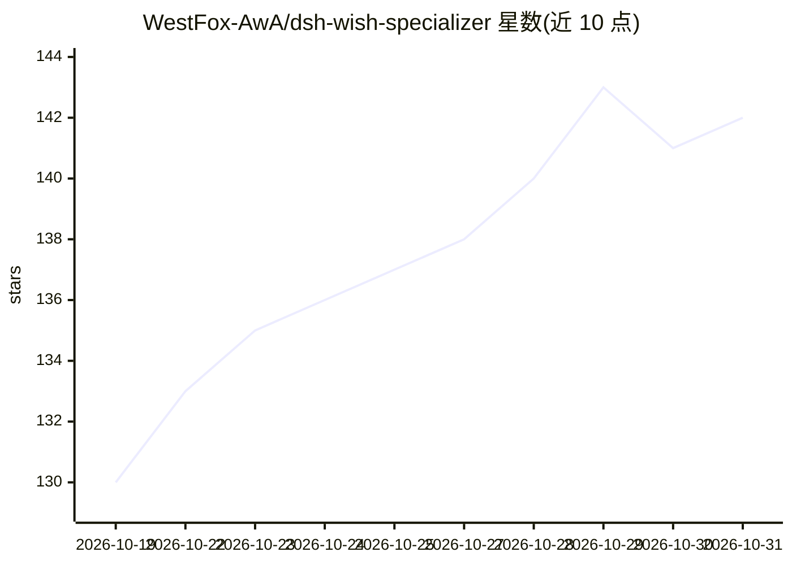

# WestFox-AwA/dsh-wish-specializer

⭐ 142 · JavaScript · BSD-3-Clause · 推送 2026-10-27 · [GitHub](https://github.com/WestFox-AwA/dsh-wish-specializer) · 个人维护 · 中文 README

**DSH 插件：发送前为你的愿望补全方向性要求**

DeepSeek Harness（DSH）的 Web 插件：在用户按下发送之前，不改写原话，补充审美基调、光影材质、构图、交互、验收口径等方向性要求，随原话一并交给工作 AI。提供四档补充程度、只读模型顾问复核、拦截确认面板、双击 Enter 跳过等机制。声明不改宿主界面与会话事件格式，不发 npm，仅从 GitHub Release 附件（.tgz）分发，当前为 v0.9.0-beta-1。

## 筛选速览

| 维度 | 判定 | 备注 |
|---|---|---|
| AI 角色 | `ai-ecosystem` | LLM/agent 周边工具 |
| 许可风险 | `permissive` | BSD-3-Clause |
| 部署形态 | `None` |  |
| 模型依赖 | — | README 未给出锁定关系 |
| 硬件要求 | — | 无带数字的原话,不猜 |
| 安装摩擦 | `low` | 无编译、无系统依赖或容器化 |
| 成熟度 | `idea` | |

## 能力要点

- 不改写原话，仅在发送前补全方向性要求（审美/光影/构图/交互/验收口径）
- 四档补充程度（关闭/轻度/标准/重度），附解释包字数预算与澄清问数上限
- 只读模型顾问独立复核，结论为可执行方向
- 兼容 dsh-0.1.7-rc.2（实测）与 dsh-0.2.0-rc.2（静态契约核对）

## 适用场景

- 短提示词一次成图/成稿前补齐没说出口的要求
- 在 DSH 中减少因需求不清导致的返工
- 查看每轮实际注入上下文的内容

## 场景标签

`提示工程` · 领域:Agent 开发

## 证据(README 行号)

> L3: **v0.9.0-beta-1** · DSH Web 插件 · 包名 `@dsh-external/dsh-wish-specializer`
> L13: 由它在你按下发送**之前**补上，随原话一起交给工作 AI。
> L21: - **不记"验收通过"**：顾问只给方向和复核，通过与否由你决定；

## 星数曲线

2026-10-19 130 → 2026-10-31 142（+12）

---
*卡片 v1 · prompt 1.4 · 生成 2026-10-22 · 置信度 high · 依据 README sha `46c800828f14` · [字段定义](../../DATASET.md)*
