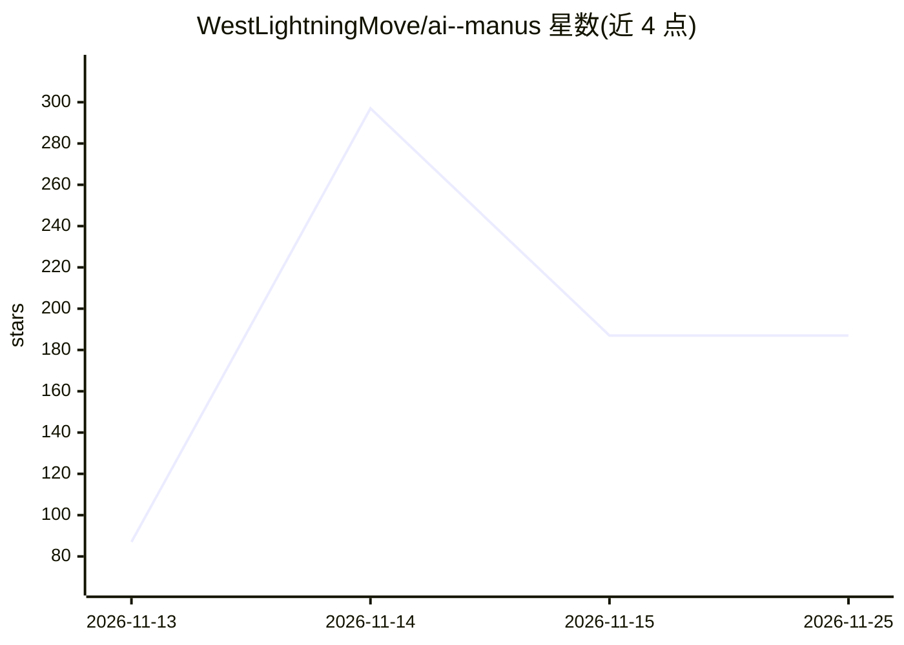

# WestLightningMove/ai--manus

⭐ 187 · Apache-2.0 · 推送 2026-11-15 · [GitHub](https://github.com/WestLightningMove/ai--manus) · 个人维护

**面向个人用户的自主 AI Agent：代写代码并操控浏览器**

一个自主式 AI Agent 系统，宣称可在用户授权下自行编写并执行脚本、控制浏览器完成页面导航、表单填写与信息收集等多步骤任务，定位为个人助手而非企业平台，面向学习、家庭与轻量办公场景。README 描述了兼容性要求（64 位系统、双核 CPU、4 GB 内存起步，推荐 8 GB）与六步上手流程，但未给出具体的安装命令、技术架构或源码运行方式，页面顶部仅有 Download Manus 与 PROMO2026 字样，无下载链接详情。

## 筛选速览

| 维度 | 判定 | 备注 |
|---|---|---|
| AI 角色 | `ai-native` | 本体是模型或模型工具 |
| 许可风险 | `permissive` | Apache-2.0 |
| 部署形态 | `None` |  |
| 模型依赖 | — | README 未给出锁定关系 |
| 硬件要求 | — | 无带数字的原话,不猜 |
| 安装摩擦 | `low` | 无编译、无系统依赖或容器化 |
| 成熟度 | — | 结构信号不足 |

## 能力要点

- 自主代码执行：agent 自行编写并运行脚本完成任务
- 浏览器控制：导航网页、填写表单、跨页面收集信息
- 代码与浏览器操作在同一流程内衔接，支持多步骤任务
- 声明记住工作流模式并跨会话复用

## 适用场景

- 让学生整理研究笔记、跑快速计算
- 让 agent 代为检查网页更新、填写重复表单
- 远程工作者从多个页面汇总信息生成简报
- 开发时快速跑小实验而无需搭完整环境

## 场景标签

`AI 助手` `浏览器自动化` `编码 Agent` · 领域:效率与自动化

## 证据(README 行号)

> L10: - **Autonomous Code Execution:** Manus AI agent runs code on its own to complete tasks, so you can focus on decisio
> L18: Manus is an autonomous AI agent designed to run code and control a browser on your behalf. Instead of acting like a

## 星数曲线

2026-11-13 87 → 2026-11-25 187（+100）

---
*卡片 v1 · prompt 1.4 · 生成 2026-11-17 · 置信度 low · 依据 README sha `0f78ee3a5dd2` · [字段定义](../../DATASET.md)*
