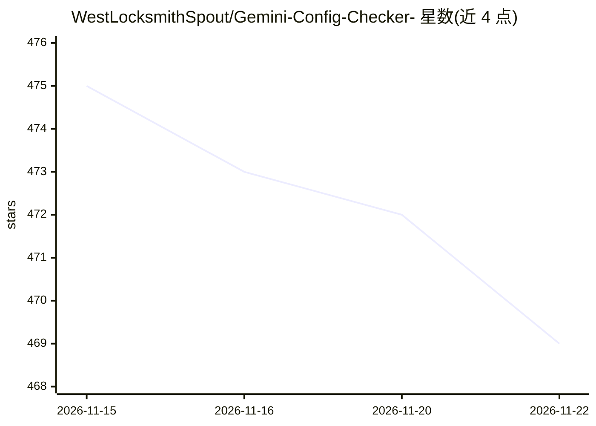

# WestLocksmithSpout/Gemini-Config-Checker-

⭐ 469 · Go · Apache-2.0 · 推送 2026-11-15 · [GitHub](https://github.com/WestLocksmithSpout/Gemini-Config-Checker-) · 个人维护 · 中文 README

**检测代理配置能否登录 Google AI Studio 与 Gemini 的桌面/CLI 工具**

面向需要通过代理访问 Google AI Studio 和 Gemini 的用户：批量测试 vless/vmess/trojan/ss 等配置，支持 Simple（直测自有配置）与 Advanced（基座配置后链式挂接免费配置换出口）两种模式。区域检测通过签名登录的浏览器实例读取 Google 的实际区域判定（识别 AI Studio 重定向与 Gemini 国家封锁提示），并内置源自 PattN 配方的抗 DPI fragment 参数（Finalmask/ALPN/加密套件）与本地分片转发器。以 Wails 桌面应用（Windows/macOS/Linux/Android APK）与 Web 服务器两种形式分发。自述为 0.1.0 早期预发布版，非 Windows 平台构建未经真机验证。

## 筛选速览

| 维度 | 判定 | 备注 |
|---|---|---|
| AI 角色 | `ai-enhanced` | 去掉 AI 部分产品仍成立 |
| 许可风险 | `permissive` | Apache-2.0 |
| 部署形态 | `desktop` | 安装包/桌面程序 |
| 模型依赖 | — | README 未给出锁定关系 |
| 硬件要求 | — | 无带数字的原话,不猜 |
| 安装摩擦 | `medium` | 含编译或系统依赖之一 |
| 成熟度 | `idea` | |

## 能力要点

- 签名登录浏览器实例读取 Google 对 AI Studio/Gemini 的真实区域判定
- Simple/Advanced 双模式，Advanced 支持基座配置链式挂接免费配置换出口
- 内置抗 DPI fragment 配置（Finalmask/ALPN/13 套加密套件）与本地分片转发器
- Windows/macOS/Linux/Android 多平台构建，附 SHA256 校验文件

## 适用场景

- 批量检测我已有的代理配置哪些能进 Gemini 和 AI Studio
- Cloudflare 配置能连但被 Google 区域封锁时，寻找可用的其他出口
- 在过滤网络环境下给配置加抗 DPI 参数后验证连通性

## 场景标签

 · 领域:网络代理/访问工具

## 证据(README 行号)

> L11: Find proxy configs that actually get you into **Google AI Studio and Gemini**, by testing each one the way a person
> L14: > **Version 0.1.0, early pre-release.** It works end to end on Windows (the only platform it has been run on so far
> L50: Google decides region availability **per signed-in account, after the page has loaded**. A plain HTTP request (even

## 星数曲线

2026-11-15 475 → 2026-11-22 469（-6）

---
*卡片 v1 · prompt 1.4 · 生成 2026-11-17 · 置信度 high · 依据 README sha `846e83cebb20` · [字段定义](../../DATASET.md)*
