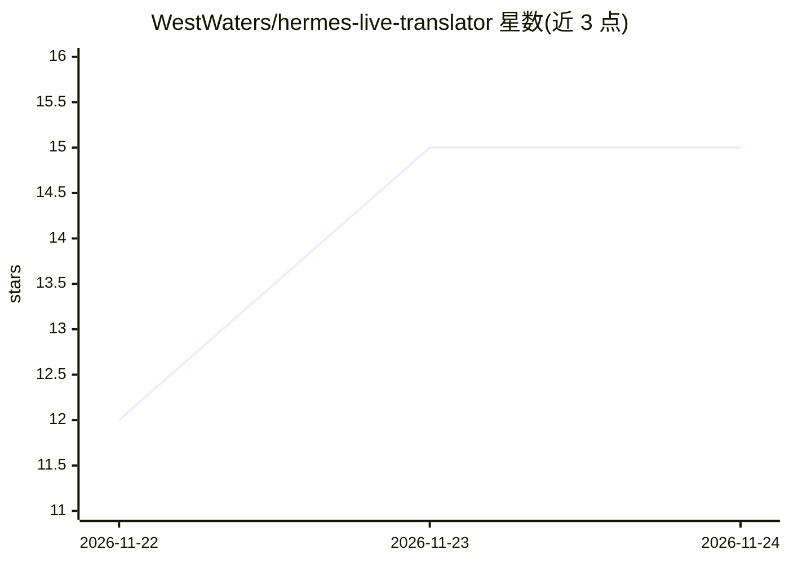

# WestWaters/hermes-live-translator

⭐ 19 · Python · MIT · 推送 2026-11-12 · [GitHub](https://github.com/WestWaters/hermes-live-translator) · [官网](https://hermes-agent.nousresearch.com/docs/plugins) · 个人维护

**本地运行的实时通话翻译器：双方各听母语、保留原声**

Hermes Agent 插件与桌面应用，在本地执行识别、翻译、语音合成全流程：识别约 100 种语言，翻译 201 种语言，可用 5 秒语音样本在 23 种语言中克隆说话人声音；支持双向同时翻译、回声消除、多说话人与语言切换。可作为 Zoom/Meet/Teams/Discord 的麦克风及 OBS 字幕源使用。模型可选本地内置（MLX/llama.cpp/CUDA）、Ollama/LM Studio 等本地服务或云订阅；安装需下载约 9 GB 模型，本地翻译时无网络传输。

## 筛选速览

| 维度 | 判定 | 备注 |
|---|---|---|
| AI 角色 | `ai-native` | 本体是模型或模型工具 |
| 许可风险 | `permissive` | MIT |
| 部署形态 | `desktop` | 安装包/桌面程序 |
| 模型依赖 | local-ok | 支持本地模型 |
| 硬件要求 | — | 无带数字的原话,不猜 |
| 安装摩擦 | `medium` | 含编译或系统依赖之一 |
| 成熟度 | — | 结构信号不足 |

## 能力要点

- 双向实时翻译，保留说话人原声（5 秒样本本地克隆，23 种语言）
- 支持约 100 种语言自动识别、201 种语言翻译
- 模型来源可本地内置、Ollama/LM Studio/llama-server/vLLM 或云订阅
- 作为 Zoom/Meet/Teams/Discord 虚拟麦克风与 OBS 字幕源接入

## 适用场景

- 与说不同语言的亲友进行实时视频通话
- 多语言会议中实时字幕与语音翻译
- 直播流中叠加多语言字幕页面
- 希望翻译数据不出本机的隐私敏感场景

## 场景标签

`语音合成` `语音识别` · 领域:内容生成

## 证据(README 行号)

> L3: **Talk to anyone, in any language, live — in their own voice.**
> L14: Someone speaks Chinese. You hear Spanish, a couple of seconds later, in **their** voice. You answer in Spanish;
> L90:   vad --> asr[Hearing Qwen3-ASR · Whisper]

## 星数曲线

2026-11-22 12 → 2026-11-24 15（+3）

---
*卡片 v1 · prompt 1.4 · 生成 2026-11-22 · 置信度 mid · 依据 README sha `4ca88069831b` · [字段定义](../../DATASET.md)*
