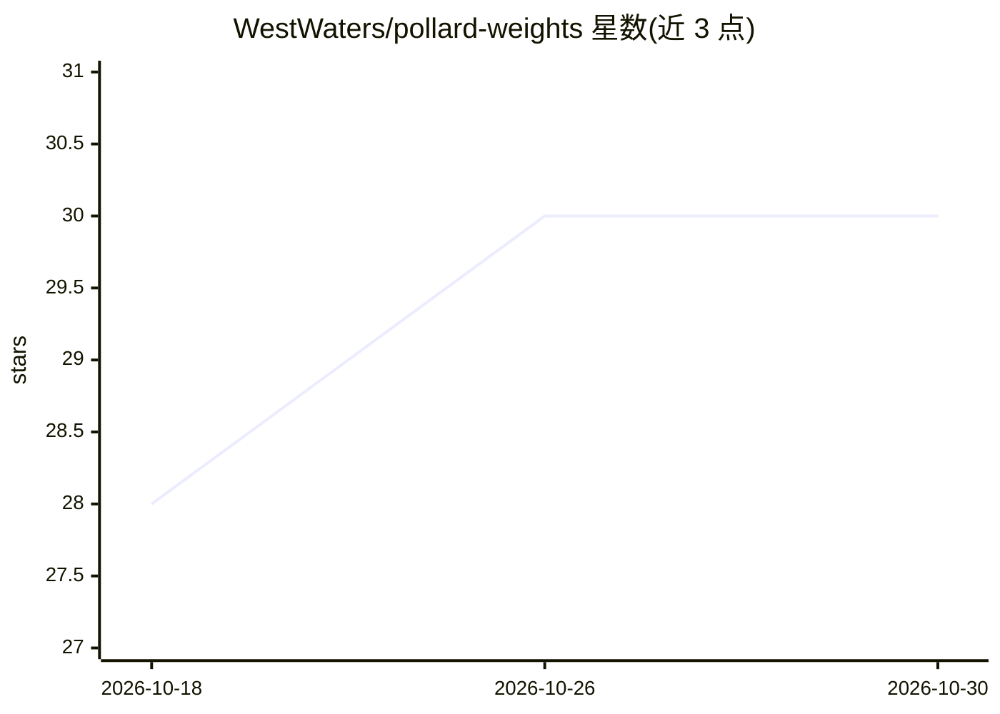

# WestWaters/pollard-weights

⭐ 30 · Python · Apache-2.0 · 推送 2026-10-29 · [GitHub](https://github.com/WestWaters/pollard-weights) · [官网](Pollard.app) · 个人维护

**按目标设备内存测量并构建量化模型的工具链**

面向在有限 RAM/VRAM 上运行大模型的开发者：先用 pollard-calc 从模型 config 预测可行性，再用 pollard-sensitivity 测量各张量敏感度（逐组压缩观察 KL），按目标预算分配比特数，输出同一份分配到 GGUF/MLX/GPTQ/MX/EXL3/EXLR8/DRAFT 七种格式，供 llama.cpp、vLLM、Apple Silicon 等运行时使用。附带 pollard-setup 环境检查安装器、pollard-verify 验证门与 pollard-doctor 修复工具。限制：需从 f16/bf16 源构建，MLX 通道需 Apple Silicon，GPTQ/MX/EXL3 需 NVIDIA GPU。

## 筛选速览

| 维度 | 判定 | 备注 |
|---|---|---|
| AI 角色 | `ai-ecosystem` | LLM/agent 周边工具 |
| 许可风险 | `permissive` | Apache-2.0 |
| 部署形态 | `library` | 以包/库形式分发 |
| 模型依赖 | local-ok | 支持本地模型 |
| 硬件要求 | — | 无带数字的原话,不猜 |
| 安装摩擦 | `medium` | 含编译或系统依赖之一 |
| 成熟度 | — | 结构信号不足 |

## 能力要点

- pollard-calc 纯 stdlib 从 config 预测模型是否装得下及速度
- 测量敏感度的比特分配（保护 attention/router/embedding，压缩 expert FFN）
- 一份分配输出七种格式：GGUF/MLX/GPTQ/MX/EXL3/EXLR8/DRAFT
- pollard-setup 按通道逐项检查并安装缺失依赖，pollard-verify 做重建验证

## 适用场景

- 下载前判断某个模型能否在我的 16GB 机器上跑
- 为手机或树莓派构建几百 MB 的量化模型
- 把大模型压到指定显存预算再交给 vLLM 或 llama.cpp 运行
- 为量化目标配一个投机解码 drafter 提升解码速度

## 场景标签

`模型量化` · 领域:训练与推理

## 证据(README 行号)

> L30: **One measured allocation, seven output lanes** — GGUF (llama.cpp/Ollama/LM Studio; trellis
> L98: |🎯 **Measured allocation**|`pollard-sensitivity` measures which tensors matter (per-model KL), then allocates bits 
> L145: |Lane|Build with|Format|Reach for it when|

## 星数曲线

2026-10-18 28 → 2026-10-30 30（+2）

---
*卡片 v1 · prompt 1.4 · 生成 2026-10-26 · 置信度 high · 依据 README sha `957f5c29414f` · [字段定义](../../DATASET.md)*
