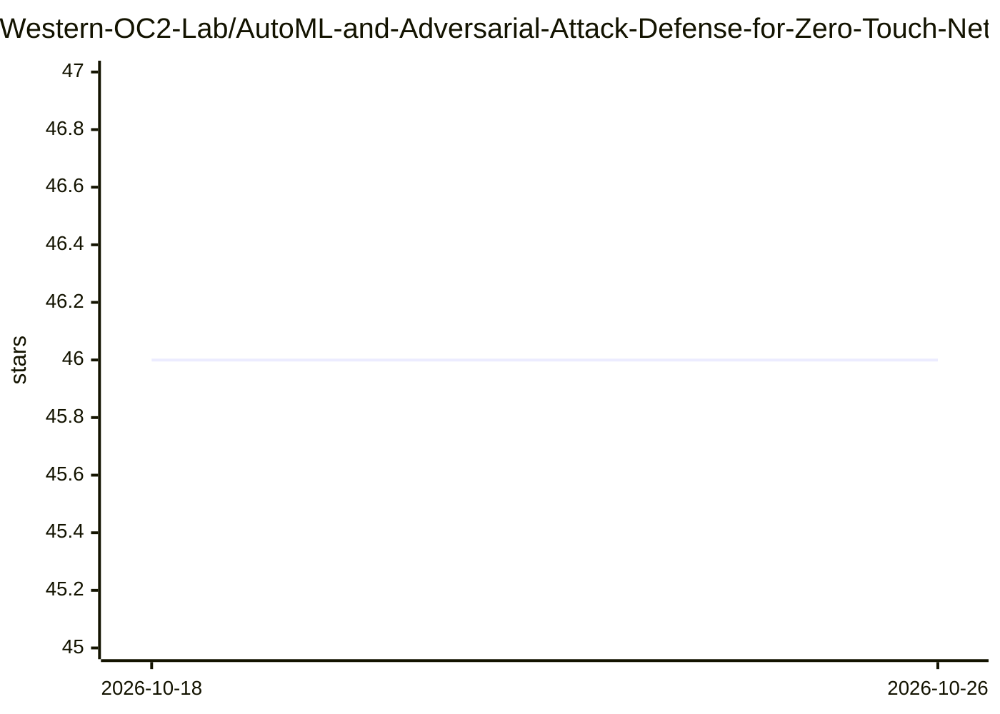

# Western-OC2-Lab/AutoML-and-Adversarial-Attack-Defense-for-Zero-Touch-Network-Security

⭐ 46 · Jupyter Notebook · MIT · 推送 2026-10-10 · [GitHub](https://github.com/Western-OC2-Lab/AutoML-and-Adversarial-Attack-Defense-for-Zero-Touch-Network-Security) · 组织维护

**论文配套代码：AutoML 构建入侵检测系统及对抗攻防**

Western OC2 Lab 发布的 IEEE TNSM 论文配套代码，以 Jupyter Notebook 形式提供 AutoML 驱动的入侵检测系统（IDS）与对抗机器学习攻防案例。AutoML 管线覆盖数据预处理、特征工程、模型选择、超参优化与概念漂移下的模型更新；静态算法含 RF/LightGBM/ANN，在线学习含 Hoeffding Tree/ARF 等；对抗攻击含 FGSM/BIM，防御为对抗样本检测与过滤。使用 CICIDS2017 与 5G-NIDD 数据集，主要在 Google Colab 上运行。

## 筛选速览

| 维度 | 判定 | 备注 |
|---|---|---|
| AI 角色 | `ai-native` | 本体是模型或模型工具 |
| 许可风险 | `permissive` | MIT |
| 部署形态 | `None` |  |
| 模型依赖 | — | README 未给出锁定关系 |
| 硬件要求 | — | 无带数字的原话,不猜 |
| 安装摩擦 | `low` | 无编译、无系统依赖或容器化 |
| 成熟度 | — | 结构信号不足 |

## 能力要点

- AutoML 管线含概念漂移下的自动模型更新
- 静态与在线学习算法（RF/LightGBM/HT/ARF/SRP）
- AML 攻击（FGSM/BIM/DTA）与对抗样本检测、过滤防御
- 使用 CICIDS2017 与 5G-NIDD 两个公开数据集

## 适用场景

- 复现论文中的 AutoML IDS 与对抗攻防实验
- 学习面向网络安全数据流的 AutoML 实现流程
- 基于公开网络流量数据集做入侵检测研究

## 场景标签

`网络安全` · 领域:学习与行业

## 证据(README 行号)

> L2: This repository includes code for the AutoML-based IDS and adversarial attack defense case studies presented in the 
> L31: * The offline AutoML-based IDS implementation for **static/batch data analytics** can be found in AutoML-based_IDS_

## 星数曲线

2026-10-18 46 → 2026-10-26 46（+0）

---
*卡片 v1 · prompt 1.4 · 生成 2026-10-25 · 置信度 high · 依据 README sha `9f469a153dab` · [字段定义](../../DATASET.md)*
