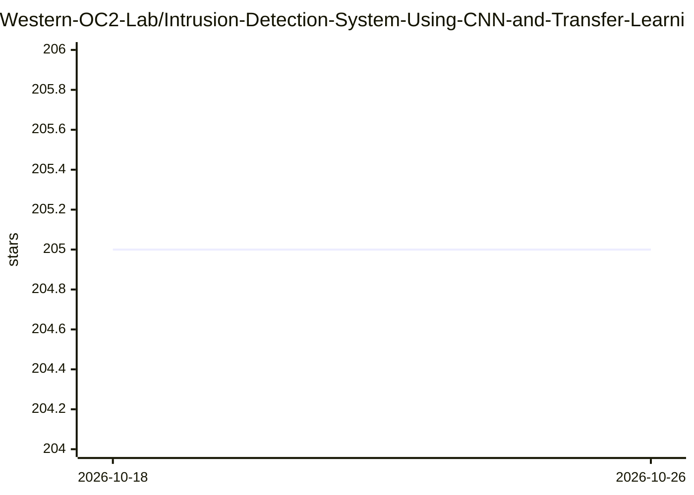

# Western-OC2-Lab/Intrusion-Detection-System-Using-CNN-and-Transfer-Learning

⭐ 205 · Jupyter Notebook · MIT · 推送 2026-04-20 · [GitHub](https://github.com/Western-OC2-Lab/Intrusion-Detection-System-Using-CNN-and-Transfer-Learning) · 组织维护

**面向车联网的 CNN+迁移学习入侵检测系统论文代码**

Western 大学 OC2 实验室发布的 IEEE ICC 2022 论文配套代码：用 CNN（VGG16/VGG19/Xception/Inception/ResNet/InceptionResNet）与迁移学习构建车联网（IoV）入侵检测系统，支持 Bagging、概率平均、拼接三种集成学习，以及 Random Search 和 BO-TPE 两种超参数优化。数据预处理阶段将表格数据转为图像，实验使用 Car-Hacking 与 CICIDS2017 两个公开基准数据集。以 Jupyter Notebook 形式提供三个流程 notebook，依赖 Python 3.5+、Keras、TensorFlow 1.10.0+、OpenCV 与 hyperopt，data 文件夹内含 CAN-intrusion 采样子集。

## 筛选速览

| 维度 | 判定 | 备注 |
|---|---|---|
| AI 角色 | `ai-native` | 本体是模型或模型工具 |
| 许可风险 | `permissive` | MIT |
| 部署形态 | `None` |  |
| 模型依赖 | — | README 未给出锁定关系 |
| 硬件要求 | — | 无带数字的原话,不猜 |
| 安装摩擦 | `low` | 无编译、无系统依赖或容器化 |
| 成熟度 | — | 结构信号不足 |

## 能力要点

- 六种 CNN 架构的迁移学习实现
- 三种集成学习（Bagging/概率平均/拼接）
- Random Search 与 BO-TPE 超参数优化
- 表格数据转图像的预处理流程，覆盖 Car-Hacking 与 CICIDS2017 数据集

## 适用场景

- 复现论文中车联网入侵检测实验
- 基于 CAN 总线数据做车内网络攻击检测研究
- 参考 CNN 迁移学习与集成学习在安全数据集上的建模流程

## 场景标签

`网络安全` · 领域:学习与行业

## 证据(README 行号)

> L7: This repository introduces how to use **convolutional neural networks (CNNs)** and **transfer learning** techniques 
> L14: Modern vehicles, including autonomous vehicles and connected vehicles, are increasingly connected to the external w

## 星数曲线

2026-10-18 205 → 2026-10-26 205（+0）

---
*卡片 v1 · prompt 1.4 · 生成 2026-10-22 · 置信度 high · 依据 README sha `595b2af323d0` · [字段定义](../../DATASET.md)*
