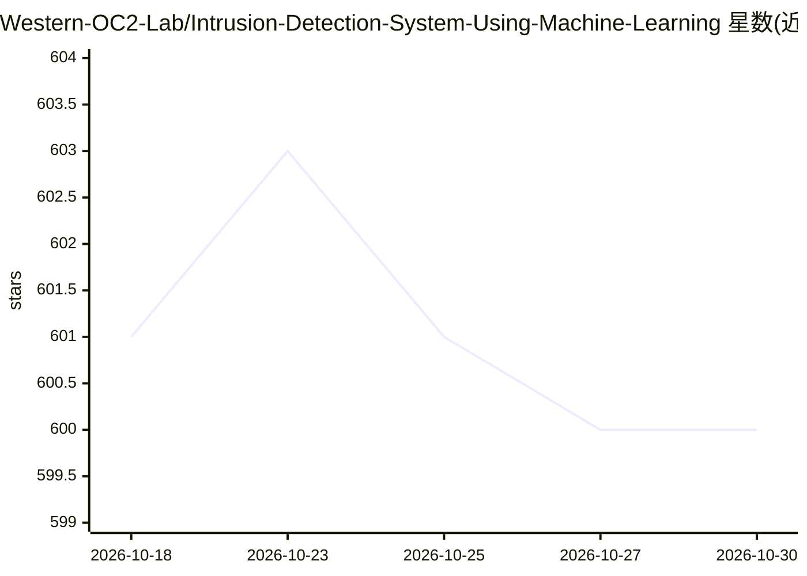

# Western-OC2-Lab/Intrusion-Detection-System-Using-Machine-Learning

⭐ 600 · Jupyter Notebook · MIT · 推送 2026-04-01 · [GitHub](https://github.com/Western-OC2-Lab/Intrusion-Detection-System-Using-Machine-Learning) · 组织维护

**科研用户的车联网/网络入侵检测机器学习代码集**

西部大学 OC2 实验室发布的三篇论文配套代码，实现三个入侵检测系统：树模型 IDS（DT/RF/ET/XGBoost）、多层混合 IDS（stacking + 贝叶斯优化 + k-means 零日攻击检测）、LCCDE 决策集成框架（XGBoost/LightGBM/CatBoost 按类别选优）。以 Jupyter Notebook 形式提供，在 CICIDS2017 与 CAN-intrusion 数据集上运行，附采样子集数据。需 Python 3.6+ 及 scikit-learn、XGBoost 等依赖库。

## 筛选速览

| 维度 | 判定 | 备注 |
|---|---|---|
| AI 角色 | `ai-native` | 本体是模型或模型工具 |
| 许可风险 | `permissive` | MIT |
| 部署形态 | `None` |  |
| 模型依赖 | — | README 未给出锁定关系 |
| 硬件要求 | — | 无带数字的原话,不猜 |
| 安装摩擦 | `low` | 无编译、无系统依赖或容器化 |
| 成熟度 | — | 结构信号不足 |

## 能力要点

- 三个 IDS 模型对应三篇已发表论文（GLOBECOM 2019/2022、IEEE IoT Journal）
- 覆盖树模型、stacking 集成、k-means 无监督零日攻击检测
- 贝叶斯优化（BO-GP 与 BO-TPE）用于超参数调优
- 附 CICIDS2017 采样子集，可处理 CAN-intrusion 数据集

## 适用场景

- 复现车联网入侵检测论文实验结果
- 在 CICIDS2017 或 CAN 数据集上开发/对比 IDS 模型
- 参考 stacking 与贝叶斯优化的超参调优实现

## 场景标签

`网络安全` `科研工具` · 领域:学习与行业

## 证据(README 行号)

> L11: This repository proposed three **intrusion detection systems** by implementing many **machine learning** algorithms
> L40: CICIDS2017 dataset, a popular network traffic dataset for intrusion detection problems

## 星数曲线

2026-10-18 601 → 2026-10-30 600（-1）

---
*卡片 v1 · prompt 1.4 · 生成 2026-10-21 · 置信度 high · 依据 README sha `89d3d47ac190` · [字段定义](../../DATASET.md)*
