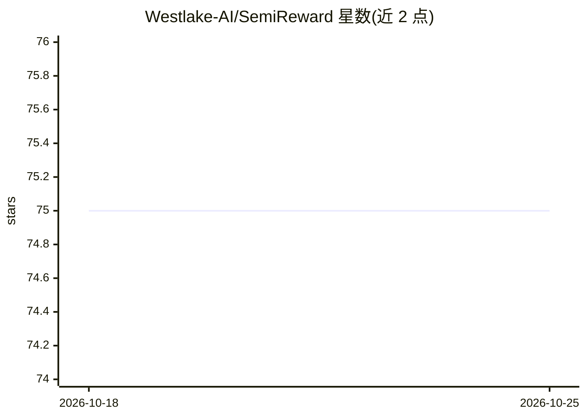

# Westlake-AI/SemiReward

⭐ 75 · Python · Apache-2.0 · 推送 2025-11-09 · [GitHub](https://github.com/Westlake-AI/SemiReward) · [官网](https://arxiv.org/abs/2310.03013) · 组织维护

**给科研者：预测奖励分数以评估半监督伪标签质量的通用奖励模型**

ICLR 2024 论文的官方实现，基于 USB（PyTorch 半监督学习代码库）。核心机制：训练一个奖励模型预测伪标签的奖励分数，用于在线评估并过滤高质量伪标签，可插拔接入 Pseudo Label、FlexMatch、Free/SoftMatch 等主流 SSL 方法；采用生成器模型与子采样策略的两阶段在线训练以缓解确认偏差。在 CV/NLP/Audio 三种模态 13 个基准上验证，覆盖分类与回归任务。默认 4GPU 训练，需先配置 USB 环境与数据集下载。

## 筛选速览

| 维度 | 判定 | 备注 |
|---|---|---|
| AI 角色 | `ai-native` | 本体是模型或模型工具 |
| 许可风险 | `permissive` | Apache-2.0 |
| 部署形态 | `self-host` | docker 或自建部署 |
| 模型依赖 | — | README 未给出锁定关系 |
| 硬件要求 | — | 无带数字的原话,不猜 |
| 安装摩擦 | `low` | 无编译、无系统依赖或容器化 |
| 成熟度 | — | 结构信号不足 |

## 能力要点

- 预测奖励分数评估并过滤高质量伪标签，可插拔到主流 SSL 方法
- 两阶段在线训练（生成器模型+子采样）缓解确认偏差
- 覆盖 CV/NLP/Audio 三模态 13 个基准，支持分类与回归
- 基于 USB 代码库，提供 pip 包 semilearn 与 Docker 训练路径

## 适用场景

- 在半监督训练中过滤低质量伪标签、缓解确认偏差
- 将奖励模型接入 FlexMatch/Free/SoftMatch 等 SSL 基线提升性能
- 复现或扩展 ICLR 2024 SemiReward 论文实验

## 场景标签

`模型训练` · 领域:训练与推理

## 证据(README 行号)

> L1: SemiReward: A General Reward Model for Semi-supervised Learning (ICLR 2024)
> L14: Semi-supervised Reward framework (SemiReward) is designed to predict reward scores to evaluate and filter out high-
> L37: Semi-supervised learning (SSL) has witnessed great progress with various improvements in the self-training framewor

## 星数曲线

2026-10-18 75 → 2026-10-25 75（+0）

---
*卡片 v1 · prompt 1.4 · 生成 2026-10-24 · 置信度 mid · 依据 README sha `2334ff8ff8c0` · [字段定义](../../DATASET.md)*
